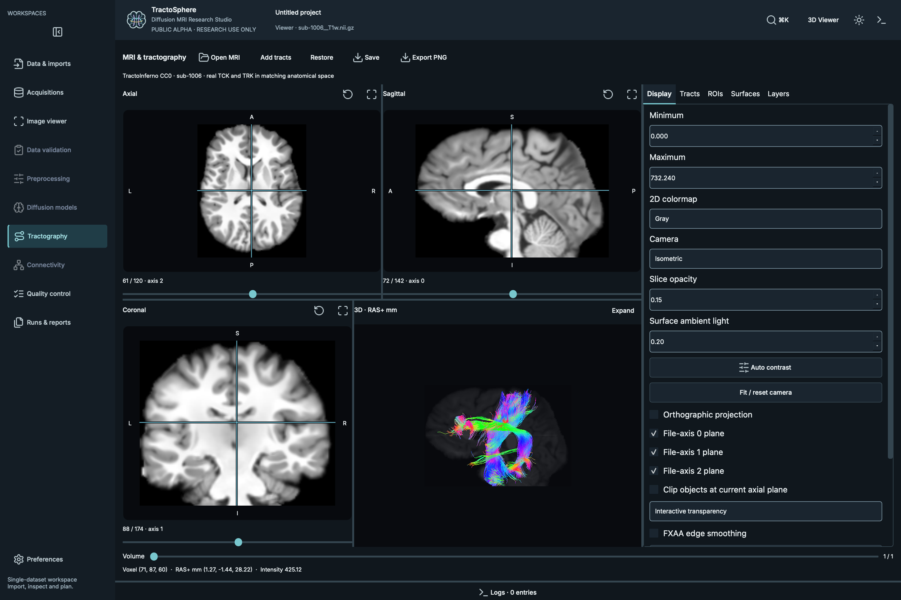

# TractoSphere

**Diffusion MRI Research Studio · From Diffusion to Discovery**

An open-source diffusion MRI research workstation for preprocessing, quality
control, visualization, tractography, and analysis.

**PUBLIC ALPHA**

TractoSphere brings a linked MRI and tractography workspace together with
metadata-aware preprocessing and saved QC. The alpha supports visualization and
editing of existing tractograms; diffusion reconstruction, new tractography
generation and connectome analysis are future capabilities.



## Try the alpha

This guide takes you from a fresh Mac to an open TractoSphere window, then
through the optional MRtrix3, FSL and ANTs setup. **Install the application first.
Add scientific tools only when you need preprocessing.**

- [1. Check your Mac](#1-check-your-mac)
- [2. Check or install Python](#2-check-or-install-python)
- [3. Download the three release files](#3-download-these-three-release-files)
- [4. Run the application installer](#4-run-the-helper)
- [5. Start with the viewer](#5-start-with-the-viewer)
- [6. Reopen the application later](#6-reopen-tractosphere-later)
- [Exact folders for MRtrix3, FSL and ANTs](#which-folders-to-select)
- [How to select, test and save each folder](#select-test-and-save-each-location)
- [Install MRtrix3](#mrtrix3-305), [FSL](#fsl) or [ANTs](#ants-265)
- [Fix macOS security popups](#macos-security-popups)
- [Understand errors and setup results](#understand-setup-results)

No AI account, API key, cloud service or MRI download is needed to launch.
For source/developer installation, Windows or Linux, see the
[other installation methods](docs/installation.md#other-installation-methods).
macOS Apple Silicon with Python 3.12 is locally verified. Other platforms have
[bounded or experimental evidence](docs/platforms.md); Windows preprocessing/WSL
bridging is unsupported.

<a id="macos-helper"></a>

## Mac: install and open the application

The release helper is the shorter installation route: you do not need to clone
the GitHub repository or install Git for this route. Python must be installed
first; this alpha does not include a standalone, notarized .app or .dmg.

Run commands one block at a time. Wait for each step to finish, and stop if it
reports an error. Copy commands from the code blocks, without a Terminal prompt
such as `%` or `$`.

### 1. Check your Mac

Open **Applications → Utilities → Terminal** and run:

```sh
sw_vers -productVersion
uname -m
```

- The pinned Qt 6.12 GUI libraries list **macOS 14.4 or newer** as their supported
  macOS range. Older macOS versions are outside that upstream support range.
- `arm64` means this Terminal is running as Apple Silicon. `x86_64` means Intel,
  or an Intel Terminal running under Rosetta. Use Python and packages matching
  your native architecture; avoid mixing Intel and ARM installations.
- TractoSphere was locally verified on Apple Silicon with Python 3.12. Intel
  Mac runtime validation remains pending. See [platform evidence](docs/platforms.md).

### 2. Check or install Python

If you already have Python 3.12, check it:

```sh
python3.12 --version
```

A result beginning `Python 3.12.` is suitable for the locally exercised Python
version. A “command not found” error means that command is not available in this
Terminal; it does not mean TractoSphere has been installed incorrectly.

If Python is missing, use a trusted distributor. For a graphical installer,
open [Python's macOS downloads](https://www.python.org/downloads/macos/), choose
the latest **Python 3.13.x macOS 64-bit universal2 installer**, and run the .pkg.
Use the standard interpreter, rather than an optional free-threaded build.
Close and reopen Terminal, then check:

```sh
python3.13 --version
```

Python 3.13 meets the application's declared Python requirement, but has not
completed the same local Mac runtime verification as Python 3.12. The helper
recognizes both commands; you do not have to rename Python or create aliases.
A maintained Python 3.12 installation from a trusted distributor is also usable.
Do not assume the newest Python major/minor release has matching GUI wheels.

### 3. Download these three release files

In Finder, create a folder named **TractoSphere-0.1.0-alpha** inside **Downloads**.
Download all three files from the same official prerelease into that folder:

| File | What it is |
| --- | --- |
| [Install-TractoSphere.command](https://github.com/kkartikeya-kulkarni/TractoSphere/releases/download/v0.1.0-alpha/Install-TractoSphere.command) | Installation helper |
| [dmri_studio-0.1.0a0-py3-none-any.whl](https://github.com/kkartikeya-kulkarni/TractoSphere/releases/download/v0.1.0-alpha/dmri_studio-0.1.0a0-py3-none-any.whl) | Application package; keep this file unextracted |
| [SHA256SUMS](https://github.com/kkartikeya-kulkarni/TractoSphere/releases/download/v0.1.0-alpha/SHA256SUMS) | Expected release checksums |

You can also find these under **Assets** on the
[release page](https://github.com/kkartikeya-kulkarni/TractoSphere/releases/tag/v0.1.0-alpha).
Keep the exact filenames; do not add `.txt` or use a duplicate ending in `(1)`.
You do not need the source-code downloads for this route.

### 4. Run the helper

Open Terminal, enter the download folder, then run the helper:

```sh
cd "$HOME/Downloads/TractoSphere-0.1.0-alpha"
```

```sh
bash Install-TractoSphere.command
```

The helper checks the wheel checksum, creates a new private Python environment,
downloads GUI dependencies, checks the installed packages and launches the app.
Keep Terminal open until it finishes. Internet access is needed for pip downloads.
Administrator rights are not normally needed for this user-local application
environment. If pip needs to compile a dependency or cannot find a matching wheel,
stop and use [troubleshooting](#understand-setup-results).

Its default environment is:

```text
~/Library/Application Support/TractoSphere/alpha-0.1.0
```

If it says **Destination exists**, it deliberately did not overwrite anything.
Try the reopening command below for an existing completed installation. For a
separate installation, choose a new environment folder:

```sh
bash Install-TractoSphere.command "$HOME/Library/Application Support/TractoSphere/alpha-0.1.0-second"
```

For a custom environment, keep the exact launch command printed by the helper.
Do not rerun the installer every time you want to open the application.

### 5. Start with the viewer

When **Software Dependencies** opens, choose **Continue with viewer only**.
MRtrix3, FSL and ANTs are optional for viewing, atlas/ROI editing and saved QC.
Add the packages below when you are ready to preprocess data.

### 6. Reopen TractoSphere later

For the helper's default installation, run:

```sh
"$HOME/Library/Application Support/TractoSphere/alpha-0.1.0/bin/dmri-studio" gui
```

This works without activating an environment or adding anything to your shell
PATH. If you installed into another folder, use the helper's printed command.

<a id="guided-scientific-software-installation"></a>

## Which folders to select

In **Preferences → Software Dependencies**, each field needs an existing
installation directory. **Select the folder containing the programs, usually
named `bin`.** Do not select an individual executable, a downloaded archive,
a Python virtual environment, an MRI data folder or an empty folder.

The installation root is also accepted when its direct `bin` subfolder contains
the expected programs. Selecting `bin` explicitly makes the choice easy to check.

Here are concrete examples; use the one that actually exists on your Mac:

| Tool field | Folder to select | Files you should find inside |
| --- | --- | --- |
| MRtrix3, using the layout below | `~/TractoSphereScientificTools/mrtrix3-3.0.5/bin` | `mrconvert`, `dwi2mask`, `dwidenoise`, `mrdegibbs`, `mrinfo` and the other required MRtrix programs |
| MRtrix3, another common layout | `~/mrtrix3/bin` or `/usr/local/mrtrix3/bin` | The same MRtrix programs |
| FSL installed into your home folder | `~/fsl/bin` | `topup`, `eddy_cpu`, `bet2`, `fast`, `flirt` and the other required FSL programs |
| FSL installed into a system folder | `/usr/local/fsl/bin` | The same FSL programs |
| ANTs, using the layout below | `~/TractoSphereScientificTools/ants-2.6.5/bin` | `N4BiasFieldCorrection` |
| ANTs, another common layout | `~/ants/bin` | `N4BiasFieldCorrection` |

`~` means your home folder. These are examples, not paths created by the
TractoSphere installer. If you installed a tool elsewhere, select that tool's
actual `bin` folder. A folder with the right name but no programs is insufficient.
Keep each complete installation together, including its `lib`, `share`, scripts
and package records when present.

### Select, test and save each location

1. Click **Locate Existing Installation** beside the package you are configuring.
2. In the Mac folder picker, press **Command+Shift+G**, enter the matching folder
   path from the table or your actual installation path, and select the folder.
   Do not include quotation marks in the folder picker.
3. Click **Test Installation** and wait for it to finish. The result must refer
   to the folder you just selected.
4. After a successful compatible test, save the paths through the guided setup
   option or **Use checked tool locations**. A plain scan does not save them.
5. Read the per-operation results. One missing optional package does not prevent
   operations that only need a different, verified package.

An explicitly selected folder takes priority over automatic discovery, even if
that folder is incomplete. If you selected the wrong folder, replace it and test
again. If you want auto-detection instead, clear that package's selection and
check again. No system PATH edits are needed for an explicitly selected folder.

### Find a location you do not know

If a tool already works in Terminal, run the corresponding command:

```sh
command -v mrconvert
```

```sh
command -v topup
```

```sh
command -v N4BiasFieldCorrection
```

For example, if the first command prints `/usr/local/mrtrix3/bin/mrconvert`,
select `/usr/local/mrtrix3/bin`. Select the containing folder, not the file.
No output means the command is not on this Terminal's PATH; it may still be
installed elsewhere. Finder-launched apps can have a different PATH.

For FSL, also check the installation root recorded by its installer:

```sh
printenv FSLDIR
```

If it prints an installation root, open that folder's `bin` subfolder and confirm
the expected files are present. Some FSL setups expose launchers under
`share/fsl/bin`; keep the full installation and its `conda-meta` records.
TractoSphere resolves supported FSL launchers back to the installed component
records rather than trusting a suite version label.

<a id="external-preprocessing-tools"></a>

## Install the scientific tools on a Mac

The application helper does not download these packages. **Install / Setup** in
the app opens guidance/downloads; it does not perform the external installation.

### MRtrix3 3.0.5

1. Open the [official 3.0.5 release](https://github.com/MRtrix3/mrtrix3/releases/tag/3.0.5).
2. Under **Assets**, download
   [mrtrix3-macos-3.0.5.tar.gz](https://github.com/MRtrix3/mrtrix3/releases/download/3.0.5/mrtrix3-macos-3.0.5.tar.gz).
   This is the universal Intel/Apple Silicon binary archive. The generic
   **Source code** archives require a separate build.
3. Double-click the archive in Finder to extract it. Preserve the whole extracted
   `mrtrix3` folder, including `bin`, `lib` and `share`.
4. In your home folder, create **TractoSphereScientificTools**. Move the extracted
   `mrtrix3` folder there and rename that folder **mrtrix3-3.0.5**. Do not move
   just the `bin` folder or replace an existing installation.
5. The selection for this layout is now
   `~/TractoSphereScientificTools/mrtrix3-3.0.5/bin`.
6. Test the executable before scanning in the app:

```sh
"$HOME/TractoSphereScientificTools/mrtrix3-3.0.5/bin/mrconvert" -version
```

Expect version **3.0.5**. If macOS displays a security popup, resolve the
[security block](#macos-security-popups) before retrying the app's test.
Then [select, test and save](#select-test-and-save-each-location) the `bin` folder.

N4 also needs the MRtrix wrapper source layout, including
`lib/mrtrix3/dwibiascorrect/ants.py`; copying executables alone is insufficient.
The release asset does not supply a publisher checksum in its metadata, so this
guide does not claim checksum authentication for it.

### FSL

**Check this before downloading:** TOPUP/EDDY in this alpha requires
`eddy_cpu` component **2401.2**, plus the installed FSL component ownership/build
records. A default/latest FSL installation can contain another version.
A correct path and a completed FSL installation do not, by themselves, establish
that the alpha will accept every operation.

If FSL is already installed, skip the download steps and locate its existing
installation with `printenv FSLDIR` or `command -v topup` as described above.
Keep a working research installation intact.

For a new, separate FSL installation:

1. Open the [official FSL macOS installation guide](https://fsl.fmrib.ox.ac.uk/fsl/docs/install/macos.html).
   Review its licensing and storage requirements. The external installer can
   change shell configuration; it is separate from TractoSphere.
2. On that page, use the **download the getfsl.sh script** link. Save it as
   `getfsl.sh` in **Downloads**. Use the official FSL link, not a third-party copy.
3. Open Terminal and run the downloaded installer:

```sh
sh "$HOME/Downloads/getfsl.sh"
```

4. Record the installation directory printed by the installer. A normal
   installation into the **fsl** folder in your home directory has:
   - Installation root: `~/fsl`
   - Folder to select in TractoSphere: **`~/fsl/bin`**
   If another location was used, select that installation's `bin` folder.
5. Wait for **FSL successfully installed**, then close and reopen Terminal.
   A downloaded installer script alone is not an FSL installation.
6. For the `~/fsl` example, confirm that the files and package records exist:

```sh
ls "$HOME/fsl/bin/topup" "$HOME/fsl/bin/eddy_cpu" "$HOME/fsl/bin/flirt"
ls -d "$HOME/fsl/conda-meta"
```

7. In TractoSphere, select **`~/fsl/bin`** in the **FSL** field, click
   **Test Installation**, and save the location when its checks pass.
   The scanner reads installed component records; do not launch TOPUP or EDDY
   without data just to obtain a version.
8. Read the per-operation results. If EDDY is detected with a version other than
   **2401.2**, or required component records are absent, its operation remains
   unavailable even though the path is correct.

This guide does not prescribe an unverified downgrade or claim a fully automated
compatible FSL installation. Use a separate compatible installation with upstream/
IT help if needed, or leave the affected operation pending. FSL's overall “6.x”
version alone cannot establish readiness.

### ANTs 2.6.5

1. Open the [official ANTs 2.6.5 release](https://github.com/ANTsX/ANTs/releases/tag/v2.6.5).
2. Under **Assets**, choose the build matching your native Mac:

| Mac | Release asset |
| --- | --- |
| Apple Silicon, macOS 14 or newer | `ants-2.6.5-macos-14-ARM64-clang.zip` |
| Intel, macOS 15 or newer | `ants-2.6.5-macos-15-intel-X64-clang.zip` |

These conservative recommendations follow the upstream build labels. They do not
establish support on an older macOS version. TractoSphere's own GUI requirements
also apply.

3. Double-click the zip in Finder. Keep the complete extracted installation,
   including `bin` and `lib`.
4. Put the folder containing those subfolders at
   `~/TractoSphereScientificTools/ants-2.6.5`. If extraction adds an outer wrapper
   folder, use the inner installation folder containing `bin` and `lib`.
5. For that layout, test:

```sh
"$HOME/TractoSphereScientificTools/ants-2.6.5/bin/N4BiasFieldCorrection" --version
```

6. [Select, test and save](#select-test-and-save-each-location)
   `~/TractoSphereScientificTools/ants-2.6.5/bin` in the ANTs field.

The app's **Verify Downloaded Archive** action can compare the pinned ANTs
archive with its official release digest before extraction. A matching digest
checks distribution integrity; it does not replace runtime or scientific checks.
See [upstream binary guidance](https://github.com/ANTsX/ANTs/wiki/Installing-ANTs-release-binaries).

## macOS security popups

A popup such as **“libmrtrix.dylib Not Opened”** or **“Apple could not verify…”**
can block an otherwise present program or shared library. Each scan may try
another executable, causing repeated popups; the app can then report
**Not verified** or a version-query timeout.

1. Click **Done** and quit TractoSphere to stop further probes.
2. Confirm the package came directly from the official upstream release you
   intended to download. Do not authorize an unknown download.
3. Use Apple's [Privacy & Security → Open Anyway procedure](https://support.apple.com/en-us/102445)
   for the blocked item where available, then retry the corresponding direct
   version command above.
4. Once the direct command works, reopen TractoSphere and test the installation.

For a trusted MRtrix3 download with repeated library blocks, an advanced,
package-scoped alternative is to remove the downloaded-file quarantine attribute
from **only that MRtrix3 installation**. For the exact recommended layout above:

```sh
xattr -r -d com.apple.quarantine "$HOME/TractoSphereScientificTools/mrtrix3-3.0.5"
```

This is a deliberate local security exception for the files in that folder,
not a safety verification. Review the source first. If your MRtrix3 folder is
elsewhere, replace only the quoted path with its actual installation root.
Do not apply it to your home folder, Downloads folder or the whole disk.
TractoSphere does not execute this command or change macOS security settings.

For ANTs or other blocked libraries, follow the same origin-review and upstream/
Apple guidance for that package. Do not assume approving `mrconvert` also
approves every shared library.

<a id="troubleshooting"></a>

## Understand setup results

| What you see | What it means | What to do next |
| --- | --- | --- |
| Application opens, scientific tools say Missing | The GUI installed; those optional packages were not found | Continue with viewer only, or install/select the packages needed for preprocessing |
| Missing / Not installed / not found | An expected executable was not found in the selected/search locations | Confirm the actual `bin` folder and its contents; correct the selection and recheck |
| Not verified / Unknown version | A file was found, but its version could not be established | Select its row and read the detail; run the direct version check and resolve security/runtime errors |
| Version query exceeded 3 seconds | A bounded version probe timed out | Check for macOS security popups, quit the app, resolve the block, then retest |
| Incomplete installation | Some required commands, records or compatible versions are absent/unverified | Read the individual rows; retain the complete installation and check per-operation availability |
| Different / unsupported version | A program exists but does not match an adapter's requirements | Use a separately installed compatible toolchain or leave that operation pending |
| Compatible version checks pass | The required software/version evidence is available | Save the locations; processing inputs and scientific QC still require their own checks |

### Common Terminal errors

- **`python3.12: command not found`:** complete the Python step first, or use the
  helper with a supported installed Python such as `python3.13`. Do not keep
  running commands that depend on an environment that was never created.
- **`source: no such file or directory: .venv/bin/activate`:** environment creation
  failed or you are in the wrong folder. The recommended helper route does not
  require manual activation.
- **`dmri-studio: command not found`:** use the full reopening command for the
  helper installation, or activate the correct source/wheel environment.
- **`cd: no such file or directory`:** check the actual folder in Finder.
  Downloading a wheel does not create a `TractoSphere` source directory.
- **Git requests developer tools:** this concerns the alternative source route.
  Complete `xcode-select --install`, then retry Git after installation finishes.
- **`No matching distribution found` / pip tries to compile GUI dependencies:**
  confirm Python, macOS version and architecture; use standard Python rather than
  mixing ARM/Intel or an unverified new interpreter. Include the first relevant
  pip error when reporting a problem.
- **Checksum failure / missing release file:** keep the three exact files from
  the same release together. Re-download any missing/mismatched file from the
  official release. The helper stops before installation on a checksum mismatch.
- **`No module named PySide6` or `vtk`:** install the GUI extra into the same
  environment used to launch the app.
- **Blank 3D view:** report Qt/VTK versions and graphics information through the
  installation issue template; correct package installation alone does not
  establish GPU compatibility.
- **Missing metadata:** supply the actual acquisition information; tool
  installation cannot supply absent phase-encoding/readout parameters.

For the default helper installation, a read-only CLI inventory is:

```sh
"$HOME/Library/Application Support/TractoSphere/alpha-0.1.0/bin/dmri-studio" doctor
```

Use **Export setup report** in the app when requesting help. Review personal paths
and remove identifying information before posting logs or screenshots publicly.
See the [dependency setup guide](docs/dependency_setup.md) for inventory options.

## What works immediately after installing the GUI

| Feature | Additional scientific software |
| --- | --- |
| NIfTI/4D viewing, TCK/TRK rendering, atlas/ROI editing and tract filtering | None |
| Saved QC reports, image comparisons, metadata/history inspection | None |
| Conversion, MP-PCA denoising, Gibbs correction and dwi2mask | MRtrix3 3.0.5 |
| Metadata-supported TOPUP / CPU EDDY | MRtrix3 3.0.5 + FSL, eddy_cpu component 2401.2 |
| Standard MRtrix/ANTs N4 correction | MRtrix3 3.0.5 + ANTs N4 2.6.5 |
| Supported T1 preparation and rigid / BBR alignment | FSL with verified component records |
| Optional matched AP/PA combination | MRtrix3 + FSL + separately verified pinned helper and pairing |

Inputs and applicable metadata are required for each operation. These existing
version gates are intentionally retained; installing the latest upstream tool
does not guarantee adapter compatibility. The [setup guide](docs/dependency_setup.md)
explains detection, guided installation, version evidence and limits. See
[platform compatibility](docs/platforms.md) for macOS, Linux and Windows/WSL scope.

## What works today

- **MRI viewing:** NIfTI-1/2 `.nii` and `.nii.gz`; linked axial, sagittal, coronal
  and interactive 3D views; 4D volume navigation, coordinates, window/level,
  colormaps, overlays and anatomical slice planes.
- **Tractography viewing:** real MRtrix TCK and TrackVis TRK; direction/uniform/
  available-scalar coloring, lines/tubes, transparency, bounded display density,
  camera presets, selection, hide/delete/cut, undo/redo and derivative exports.
- **Regions and anatomy:** binary masks, surfaces, named discrete atlases and
  thresholded probability maps; grouped ROIs, colors/opacity, drawing/morphology,
  inclusion/exclusion filtering of existing streamlines and workspace persistence.
- **Reviewed preprocessing:** explicit input/history validation, native conversion,
  MP-PCA denoising, Gibbs correction, masking, metadata-gated TOPUP/EDDY,
  MRtrix/ANTs N4 and supported anatomical preparation/rigid/BBR alignment.
  Optional matched AP/PA combination has strict pairing and producer requirements.
- **QC and provenance:** separate execution, numerical verification and scientific
  review states; saved metrics/figures/logs, before/after comparisons, portable
  report access/export, input/output hashes and immutable attempt directories.
- **Projects:** acquisition identities, BIDS discovery, inherited metadata,
  saved processing histories and limited verified native-stage continuation.
- **Scripting:** core Python APIs and `dmri-studio` CLI. 

Read the [feature overview](docs/features.md), [quick start](docs/quickstart.md),
[atlas guide](docs/atlas.md), [scientific limitations](docs/limitations.md) and
[validation record](docs/validation.md). The
[DSI-style viewer compatibility matrix](docs/viewer-compatibility.md) describes
behavior and limits rather than claiming exact DSI Studio parity.

## Scientific boundaries

Original scientific files are preserved. Visualization settings do not change
source voxel values. Atlas registration is never inferred from matching array
sizes or a visually plausible overlap. A known MNI/native mismatch requires a
verified transform or a verified atlas already in the subject's space.

Missing acquisition parameters stay missing. MP-PCA must precede interpolation;
standard Gibbs correction does not establish complete partial-Fourier correction.
QC flags do not authorize volume deletion or mask repair. Successful execution
and visually smooth outputs do not establish scientific acceptance.

This alpha has bounded software tests and small-cohort research experience.

## Feedback and contributions

- [Bug reports and installation problems](https://github.com/kkartikeya-kulkarni/TractoSphere/issues)
- [Feature requests and scientific QC questions](https://github.com/kkartikeya-kulkarni/TractoSphere/issues/new/choose)
- [Researcher discussions](https://github.com/kkartikeya-kulkarni/TractoSphere/discussions)
- [Contribution guide](CONTRIBUTING.md) · [Security policy](SECURITY.md)

Share sanitized logs and reproducible public/synthetic examples. **Do not upload
identifiable patient data, restricted MRI files, private study records, credentials
or screenshots containing personal information.**

## License and citation

TractoSphere's own source is MIT licensed. Bundled fonts and icons retain their
original licenses; external scientific tools have separate terms and are not
bundled. See [LICENSE](LICENSE) and [third-party notices](THIRD_PARTY_NOTICES.md).
Use [CITATION.cff](CITATION.cff) when citing this software. This alpha has no
software-paper DOI; references are not fabricated.
