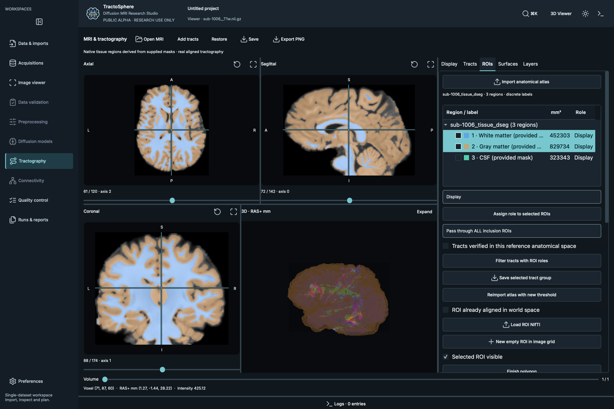
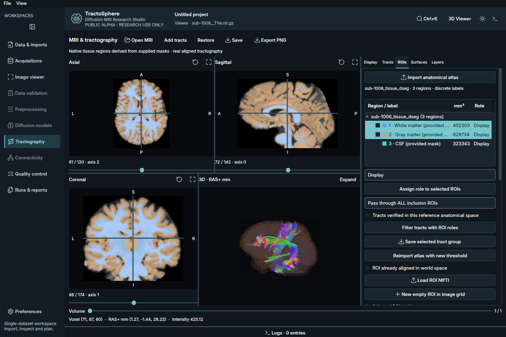

# Phase 3 — Cross-platform compatibility and validation

2026-10-14 · PUBLIC ALPHA · RESEARCH USE ONLY · NOT FOR CLINICAL USE

This phase improves portability without changing scientific calculations or tool
version acceptance. It does not establish universal preprocessing readiness.
[Platform support matrix](platforms.md) is the authoritative support statement.

## Implementation and architecture audit

| Area reviewed | Result / change |
| --- | --- |
| Packaging | Platform-independent application wheel; platform-specific upstream scientific/Qt/VTK wheels remain separate. Source and noneditable wheel installs checked in macOS and clean Ubuntu ARM64 environments. |
| Paths / filesystem | pathlib and argv retained; Unicode/spaces exercised with actual NIfTI/TCK/TRK load/export and subprocesses. Exclusive no-overwrite exports retained. Hard-link-capable filesystem required for atomic publication. |
| Temporary files / permissions | Existing closed temporary-file publication reviewed, including Windows open-handle constraints. No overwrite fallback, shared global temp path or permissions bypass introduced. |
| Scientific discovery | Existing manager extended, not rebuilt: Windows selected root/bin and ANTSPATH recognize .exe; non-native scripts/batch/WSL/FSL are not queried as native tools. Explicit incomplete directories remain authoritative. |
| Scientific compatibility | MRtrix 3.0.5, CPU EDDY component 2401.2 and ANTs N4 2.6.5 unchanged. Binary/version/source hashes and independent execution preview gates preserved. |
| Subprocesses / cancellation | Shell-free argv, quiet-pipe cancellation, exact logs, no-overwrite and owned POSIX process groups retained/tested. Windows direct-child cancellation only; no WSL/child-tree integration claim. |
| CPU / memory | Windows read-only psutil RSS and lifetime-average CPU added. Existing Unix ps semantics retained. Benchmark/inspection scripts no longer import Unix resource on Windows; OS peak RSS units are normalized explicitly. |
| Qt / VTK / OpenGL | macOS presentation workaround preserved. Linux actual X11/Mesa rendering tested. Native framebuffer screenshot-export defect fixed without altering on-screen rendering or scientific geometry. |
| Settings / dialogs / themes | Existing QSettings/platform user store retained. Actual dark/light workspaces, setup dialog, small-window smoke, packaged fonts/icons and saved workspace verified. |
| Atlas / ROI / QC text | Explicit UTF-8 text I/O prevents locale-dependent corruption on Windows. Tests simulate a non-UTF8 default locale for accented/Greek region names. Background 0, label IDs and scientific label handling unchanged. |
| Data integrity / exports | Real public source hashes unchanged; affine/tract coordinates and volume navigation checked. No source MRI, gradients, algorithms or acceptance thresholds modified. |

New shared modules: `core/resources.py`, `gui/capture.py`. Existing dependency,
process, atlas, QC and viewer services were extended. No duplicate dependency
manager, new scientific backend or unrelated GUI redesign was introduced.

## Test execution

Final results and commands are recorded in the phase evidence; see the table below.
The original private checkout and public candidate deliberately have different
suite sizes because study-only private tests are not distributed.

| Environment | Final automated result | Limits |
| --- | --- | --- |
| macOS 26.3 / Apple M5 / 16 GB, public candidate | 762 passed, 2 skipped; 174.16 seconds | Optional locally verified N4 and pinned AP/PA combination integration checks unavailable in the candidate venv |
| Ubuntu 24.04 ARM64 VM / 2 vCPU / 3 GiB, installed wheel | 749 passed, 15 skipped; 150.71 seconds | Scientific executables absent; skips explicitly cover external integration/planning checks, not fabricated algorithm passes |
| Original development checkout, same Mac | 803 passed, no skips; 173.44 seconds | Private study checks included; no expensive EDDY processing |
| Windows, Intel Mac, Linux x86-64 | No execution | Matching dependency wheels/CI configuration are preparation, not native validation |

Commands: `python -m pytest -q --junitxml=...`; Linux uses
`LIBGL_ALWAYS_SOFTWARE=1 xvfb-run -a -s '-screen 0 1440x960x24' ...`.
`python -m pip check`, noneditable package/asset checks, Ruff, `git diff --check`
and actionlint also passed. Final wheel/sdist contents contain the new modules
and no MRI/tract arrays. Source-install and wheel-install checks are distinct.

### Actual GUI and data checks

The small platform smoke uses **generated geometry**, explicitly not biological
tractography evidence. It checks startup/no AI, reduced-motion welcome, linked
four-volume navigation, independent TCK/TRK coordinate correspondence, two-region
atlas population and 3D masks, opacity/edit/undo, workspace roundtrip, dark/light,
small window, dependency panel/guided dialog and nonuniform actual VTK pixels.

Separate tests used the existing permitted **TractoInferno / OpenNeuro ds003900,
CC0, sub-1006**: corresponding T1, 65-volume DWI, AF_L TCK (18,375 streamlines),
PYT_L TRK (65,734 streamlines) and disjoint supplied WM/GM/CSF masks. The derived
three-label fixture is a tissue-mask label map, not a cortical parcellation.
Both macOS and Linux exercised real imaging/tract data, atlas surfaces, morphology/
undo and actual volumetric inclusion/exclusion filtering. All seven source hashes
matched before/after. No additional research MRI was downloaded for this phase.

Native macOS screenshots:

Ubuntu VM X11/Mesa screenshot (not physical GPU evidence):

Linux used Python 3.12.3, PySide6 6.12.0, VTK 9.7.1 and Mesa llvmpipe
LLVM 20.1.2 / OpenGL 4.5. Native macOS uses Python 3.12.15 and PySide6 6.12.0.
VTK/Qt versions and renderer capability strings are saved in the smoke JSON.
No mockups or generated screenshots substitute for application captures.

A temporary local LaunchServices .app audit wrapper opened the final installed
wheel through Finder's launch mechanism with PATH restricted to /usr/bin:/bin.
It completed the GUI smoke and guided-dialog checks with exit 0. This is evidence
on the same Mac, not a notarized/frozen application package or independent clean
Mac installation. The wrapper was not distributed and did not change system PATH.

[Actual macOS guided setup screenshot](screenshots/phase3-macos-setup.png).

## Failures investigated and fixes

1. **New diagnostic harness errors:** accessed the lazy viewer before opening it;
   opacity assertion selected the wrong row. Fixed harness initialization/selection,
   kept numerical contracts and preserved failed-attempt logs. These were test
   harness defects, not scientific algorithm failures.
2. **Linux native-OpenGL screenshot corruption:** QWidget.grab produced blank or
   random pixels in the 3D child while direct VTK and X11 screen captures were
   correct. New capture helper composites actual VTK framebuffer pixels at the
   child's Qt coordinates/DPR. Workspace export and validation captures use it.
   A regression test injects a magenta invalid Qt capture and verifies replacement
   with the real VTK framebuffer. Physical on-screen rendering was not replaced.
3. **Constrained Linux real-data filter timeout:** the 120-second harness wait was
   insufficient for full volumetric filtering on 2 vCPUs. A separate attempt used
   an explicit 300-second worker timeout and passed the same data/ROI/hash checks.
   No algorithm, filtering result, dataset, density criterion or acceptance
   threshold was changed. The configurable test timeout is not a processing ETA.
4. **Xcursor runtime warning in minimal Ubuntu:** installed the distro's libxcursor1
   in the isolated VM and added it to the documented Ubuntu/CI library list.
5. **Platform gaps fixed proactively:** native .exe root discovery, Windows process
   metrics, Unix-only resource imports/units and locale-dependent atlas/QC text.
   Windows-specific contracts are simulated until native CI/hardware can run.

## CI and remaining limits

CI covers explicit macOS ARM/Intel, Ubuntu x86-64 Python 3.12/3.13 and Windows
Server 2022 runners, wheel/sdist build, installed assets, dependency resolution,
core/CLI/numerical/GUI tests and VTK-pixel smoke artifacts. actionlint passed.
Jobs remain **public-repository-only** to avoid paid private CI use. No remote
runner result or Windows 10/11 client-desktop verification is claimed.

Windows-to-WSL processing remains unsupported. Official WSL commands/path tools
were researched; distribution binding, Linux FSL discovery, working directories,
file access, environment, cancellation and output verification were not implemented
as an untested partial bridge. Native Windows ANTs/MRtrix availability does not
validate this application's adapters. See [platforms](platforms.md) for sources.

Pending: independent clean Mac, Intel Mac, Windows client desktops, Linux x86-64,
physical Linux GPU, native Wayland, Linux scientific-tool end-to-end execution and
remote CI. These experimental-platform gaps alone do not prevent a bounded macOS
alpha. Earlier independent-installation and historical-security publication gates
are unchanged. Repository visibility and release remain private; no Git history
cleanup, publication or next phase was started.
