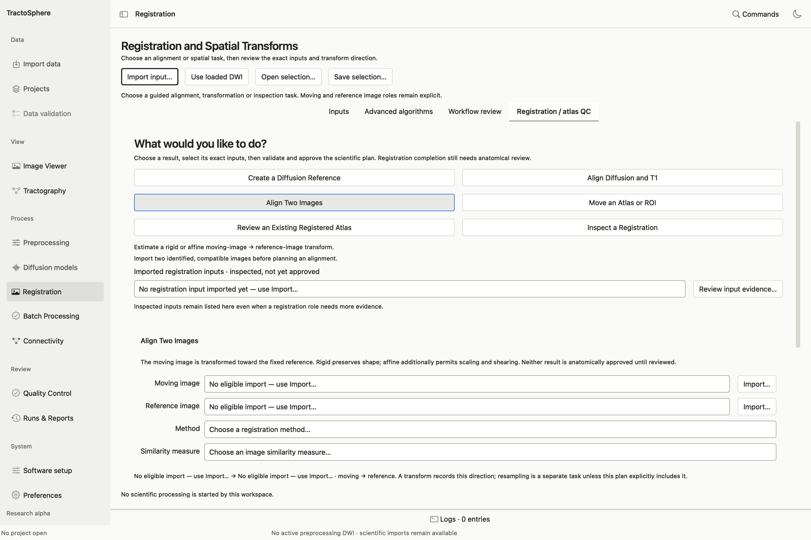
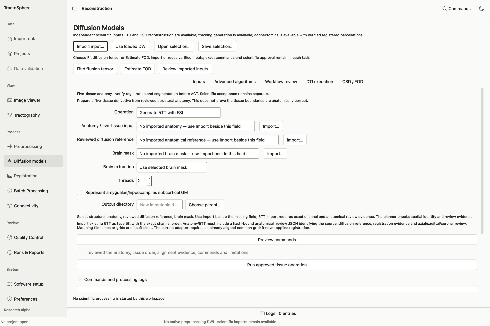

# Prepare anatomy, register images and review atlases

*Start by choosing the goal that describes the files you have. The moving image is transformed toward the fixed reference; read that direction again in the command preview.*

Keep moving/fixed image direction explicit. Registration creates a transform and often a resampled image; neither technical success nor a plausible single slice is an anatomical approval.

## Prepare T1 anatomy

Import the same participant's T1 as **anatomy**, with subject/session, `T1_NATIVE` space, true preparation history and image contrast. In **Preprocessing → Prepare anatomy and white-matter candidate for review**, open **Anatomical inputs, history and review**. Select the T1 and the available route-specific companion files. For example, an MP2RAGE route may need its associated INV2 image; do not use a different acquisition's companion. Preview BET/FAST or other selected commands, run to a new output folder, and open the brain-extracted image and candidate WM segmentation in all three planes. A saved mask is a candidate until a reviewer checks its coverage and tissue boundaries.

## Create a diffusion low-b reference

1. Open **Registration → Create a Diffusion Reference**.
2. Select a **Preprocessed DWI** with its verified gradients and correction history. If already imported only into a different panel, use **Use imported DWI in Preprocessing** to revalidate the association; this action does not invent history.
3. Choose **Mean of all selected low-b measurements** or **First measurement that meets the threshold**, and set the **Maximum included b-value** (0–200 s/mm²). Inspect which volumes qualify.
4. Choose a new derivative folder, **Validate and Preview Plan**, read the exact command, approve and run. Save its reference record JSON. This creates a fixed image for later registration; it does not align a T1 or atlas.

## Choose a guided registration goal

All executable Registration goals use: **select exact inputs → review direction and parameters → choose a new output directory → Validate and Preview Plan → inspect command/transform direction/interpolation → approve → run → inspect result and QC**. Changing a field invalidates approval.

| Goal | Files to select | What happens next |
| --- | --- | --- |
| **Align Diffusion and T1** | Moving EPI/b0 reference; fixed T1; brain-extracted T1; associated WM segmentation | EPI/b0 → T1 boundary-based alignment; inspect three-plane result |
| **Align Two Images** | Moving image and fixed reference; choose rigid or affine and similarity measure | Source → target transform plus registered image; rigid uses rotation/translation, affine can scale/shear |
| **Move an Atlas or ROI** | Atlas labels, binary ROI, continuous image or probability image; exact target reference; verified source-to-target transform | Resamples derivative with type-appropriate interpolation; no inverse/chain is guessed |
| **Review an Existing Registered Atlas** | Existing registered atlas and its **exact verified low-b reference** | Creates image-only QC; no new registration |
| **Inspect a Registration** | Current verified result, previous run or saved atlas QC | Opens Viewer comparison and review tools; starts no processing |

In **Align Two Images**, choose a method (rigid or affine) and similarity measure (mutual information, normalized mutual information, correlation ratio, normalized correlation or least squares) that fits the image contrasts. The app shows moving → fixed direction. For a T1→DWI chain, select T1 as moving and the exact verified low-b as fixed. For EPI→T1, the direction is the reverse; do not apply that matrix as if it were T1→EPI.

## Move a public atlas into subject diffusion space

1. Obtain a legally reusable atlas and its label table; keep its license/source citation. Schaefer labels are one example. Confirm whether its coordinate space matches the selected template; equal dimensions alone are insufficient.
2. If needed, **Align Two Images** from a template image to the participant T1. Review its output and exact transform. Import the atlas as **atlas labels** with its source-space association.
3. Choose **Move an Atlas or ROI**, select the atlas, participant T1 target and corresponding verified transform. Preview to confirm source → target direction and **nearest-neighbor** treatment of discrete labels. Run to a new folder; check that parcel IDs survived and inspect overlays. This produces an atlas in T1 space, not yet DWI space.
4. Establish and review T1→verified-low-b alignment. Then use **Move an Atlas or ROI** again with the T1-space atlas, verified low-b target and T1→DWI transform. Inspect axial, sagittal and coronal boundaries and node IDs.
5. Use **Review an Existing Registered Atlas** on the final atlas and exact low-b reference. Record the qualified atlas alignment decision in the saved QC bundle. Connectivity requires appropriate accepted evidence or an explicitly identified diagnostic mode.

The atlas manager's direct load is for viewing. It does **not** estimate registration. See [atlas and ROI details](../atlas.md) for discrete vs probabilistic input rules.

## Reuse an already registered atlas

If the atlas is already in the participant's DWI space, **do not rerun registration merely to create a new transform**. Import it as atlas labels. Attach its verified TractoSphere **registration run manifest JSON**, or a genuine hash-bound atlas-to-reference QC association for an external result. Import the exact verified low-b reference. Select **Registration → Review an Existing Registered Atlas**, preview the QC-only plan, run it, inspect overlays/outlines/checkerboard in three planes and save a reviewer decision. Missing provenance cannot be replaced with “it looks aligned” or an invented matching-space label. An external atlas with undocumented registration may remain blocked until its source, transform and reference evidence is recovered.

## Advanced Registration Tools

Open **Advanced Registration Tools** for exact typed tasks: create a reference, FLIRT rigid/affine, EPI-to-T1 `epi_reg`, supported FNIRT, transform inversion, composition or conversion, and resampling of scalar images, atlas labels, ROIs and probability maps. Select the operation, choose **Select inputs and parameters…** or **Import existing transform…**, then review exact source/target identity and format. For an imported transform, provide its original file, software/version, direction/image-association evidence and a **new** record JSON. Unsupported transform conventions or wrong source grids should remain blocked. Advanced tools are not a shortcut around human QC.

## Five-tissue anatomy and GM–WM seeds

*The 5TT task needs its anatomy, reviewed diffusion reference and brain mask. Previewing commands checks file associations; it does not replace visual review of cortical GM–WM, subcortical GM, WM and CSF boundaries.*

1. In the Anatomy/5TT task, choose **Generate 5TT with FSL**. Select the aligned, reviewed anatomy, exact **Reviewed diffusion reference**, and brain extraction choice: selected brain mask, already brain extracted, or native automatic extraction. Add the mask only when it belongs to this anatomy. Optional amygdala/hippocampus subcortical-GM handling and threads are explicit controls.
2. Select a new output directory and **Preview commands**. Read the `5ttgen fsl`/`5ttcheck` plan, exact alignment review and current grid restriction before approval. Run and open **Review QC**.
3. To check an existing five-channel image, choose **Validate imported 5TT**. To make compartment views, choose **Inspect tissue compartments** (`5tt2vis`) and use **Open compartment**. Review cortical GM, subcortical GM, WM and CSF over the actual T1 in axial, coronal and sagittal planes; a colored fraction is not itself a hard boundary.
4. Have a qualified reviewer record **accepted**, **needs_review** or **rejected** for the exact 5TT bytes, with actual observations. If using the saved 5TT in a new task, import it as type **5tt**, declare the exact channel order and attach the saved **Accepted exact 5TT tissue QC review JSON** in its import form. **Generate GM–WM interface seeds** (`5tt2gmwmi`), ACT tracking and ACT SIFT2 require that accepted exact-5TT tissue review. T1 alignment approval and `5ttcheck` do not substitute for this decision.

**Current scientific limit:** this branch's 5TT GUI path requires anatomy and diffusion reference on the same physical voxel grid. Resampling a high-resolution T1 to a coarser DWI grid can discard tissue detail. MRtrix's [5ttgen guidance](https://mrtrix.readthedocs.io/en/3.0_rc3/troubleshooting/FAQ.html#encountering-errors-using-5ttgen-fsl) recommends retaining T1 resolution. A reviewer may accept a specific existing 5TT, but that decision does not validate a general native-resolution workflow or all ACT results. The app does not yet offer a validated header-only T1 transform path; see [known limitations](../limitations.md).
