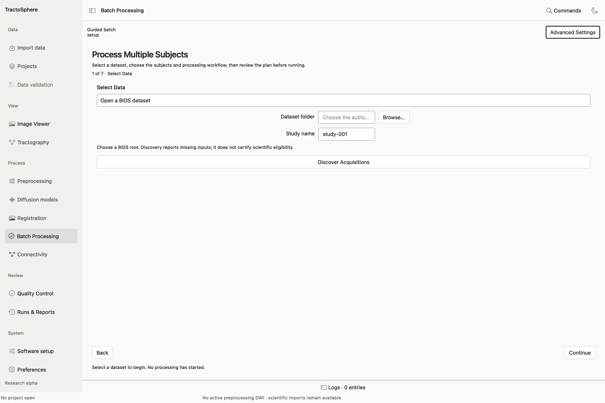

# Process multiple acquisitions in Batch Processing

*The wizard begins with a BIDS root or another discovery source. Browse to the dataset, name the study and select Discover Acquisitions. Discovery lists candidates; later wizard pages determine which stages are eligible.*

**Batch Processing** has seven guided pages and an **Advanced Settings** view for saved workflow JSON, exact commands, resource limits and journal controls. Begin with a bounded subset so you can inspect each subject's eligibility and disk estimate.

1. **Select Data:** choose a BIDS root, **Custom folder mapping (JSON)**, **Acquisition table (CSV/TSV)** or a saved study/batch. A BIDS root needs a readable `dataset_description.json` with name and BIDS version. A custom mapping assigns roles such as DWI, bval, bvec, JSON, mask and T1 by exact patterns; zero/multiple matches need correction. **Discover Acquisitions** reads files only.
2. **Review Subjects:** search/filter and select the intended subject, session and acquisition records. Inspect missing/ambiguous inputs; discovery does not prove scientific eligibility. Return to data selection if a different root or mapping is needed.
3. **Choose Workflow:** guided presets cover **validated DWI → MRtrix conversion** and **FA/MD/AD/RD from an existing tensor** where required roles exist. Other supported definitions can be loaded through saved workflow/Advanced Settings. Conversion still requires explicit processing-history review. A task can be eligible for some acquisitions and blocked for others.
4. **Configure:** choose a **new** output folder and review software locations and advanced concurrent-subject/process, thread and memory limits. The displayed saved installation is not a substitute for exact command validation.
5. **Review Plan:** choose **Validate Processing Plan**. Read eligible, deferred and blocked stages; open **Inspect Exact Commands and Provenance**. Approve only this exact plan. Changing subjects, workflow, output, software or resources invalidates the approval.
6. **Run & Monitor:** choose **Run Approved Batch**. Inspect journal counts, individual stage details and real logs. **Pause** stops new scheduling rather than immediately killing a running external command. Resume, selected cancellation, batch cancellation and retry use the saved journal and implementation/tool identities. Do not edit a previous run to make resume pass.
7. **Results & QC:** select each stage, open its manifest and verified products, inspect compatible images in Viewer and read study/registration QC. Record a scientific review separately. Reopening a batch shows its historical state; **New Batch With Current Software** makes a distinct plan rather than rewriting the previous one.

The [Batch Processing reference](../batch_processing.md) explains saved definitions and CLI parity. The real-data audit covered a small guided batch conversion/map route and one completed resume check; pause/cancel/retry, multi-subject scientific acceptance and all advanced adapters remain incompletely tested. Treat those actions as available controls with the stated evidence limits, not as validated for every study.
