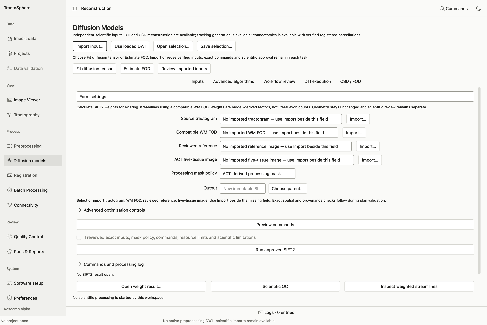
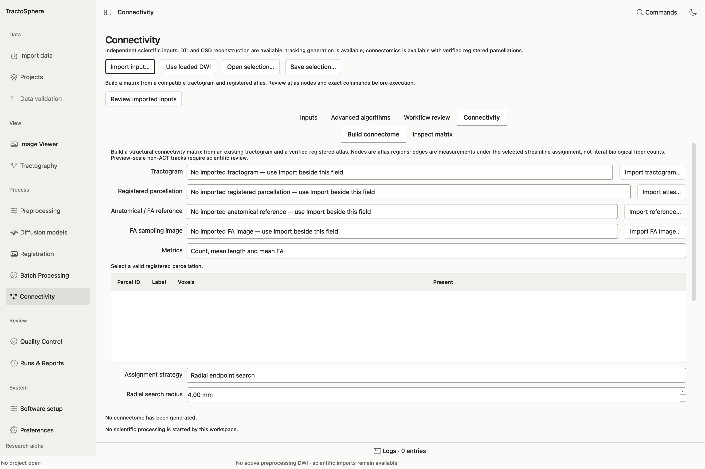

# SIFT2 weights and structural connectivity

SIFT2 and a connectome use **existing** streamlines. They do not create anatomical validity. Begin with a tractogram whose exact source FOD, subject, coordinate space and processing path are known. Save all outputs in new attempt directories.

## Compute SIFT2 weights

*The source tractogram and WM FOD must belong to the same reconstruction path. Select the mask policy, preview the exact command and inspect the saved factor QC after the run.*

1. Open the dedicated **SIFT2** task in the scientific workspace. Select the **Source tractogram**, **Compatible WM FOD** and **Reviewed reference**. The tractogram must be associated with that exact FOD; equal geometry is not enough.
2. Choose a **Processing mask policy**: **Explicit processing mask**, **ACT-derived processing mask**, or **Native whole-FOD model**. Supply a matching mask for the first policy or an accepted exact 5TT for ACT. Do not select ACT simply to bypass a mask blocker.
3. Leave advanced optimization values at native defaults unless you have a protocol. The panel exposes regularization, iteration bounds, density thresholds, optimizer coefficient/factor bounds, threads and optional heuristic GM scaling. GM scaling has extra single-tissue/ACT requirements.
4. Choose a new output directory, click **Preview commands**, check the exact files, policy, `tcksift2` command and resource limits, then approve and **Run approved SIFT2**.
5. Open the weight result, inspect the histogram and an original **Source index (0 based)**, and use **Scientific QC** / **Inspect weighted streamlines**. The factor count should correspond to the source tractogram. Nonnegative finite factors or optimizer convergence alone do not establish biological reliability. SIFT2 factors are not literal axon counts.

## Build a connectome

*Start with the tractogram and registered parcellation, then add the anatomical/FA reference and optional exact-source weights. Review atlas QC, node IDs and assignment policy before building a matrix.*

1. Open **Connectivity** and select the **Tractogram**, **Registered parcellation**, and **Anatomical / FA reference**. For FA metrics, select an exact compatible **FA sampling image**; for weighted metrics, select its source-associated **SIFT2 weight factors**. If the atlas is missing its accepted registration QC, click **Review atlas registration…** and complete [that GUI workflow](anatomy-registration.md#reuse-an-already-registered-atlas) first.
2. Inspect the node table: original parcel IDs, labels, voxel counts and presence are shown. A missing parcel must not silently renumber later rows.
3. Choose **Metrics**: count/mean length/mean FA together, all six weighted and unweighted metrics, or one named metric. Choose an **Assignment strategy**: radial endpoint search, endpoint voxel lookup, reverse inward search, or forward outward search. Review radial radius or forward/reverse limit in millimeters as appropriate.
4. Under **Advanced matrix policies**, review whether to mirror off-diagonal edges, zero the diagonal and set threads. These are analysis choices; record them with the result.
5. Choose a new output directory, click **Preview commands**, inspect source/atlas/reference/FA/weight associations and the exact assignment/aggregation commands, approve and **Build connectome**. If an evidence gate blocks preview, recover the missing source or review record rather than relabeling files.
6. Open the matrix. Select a cell by click or keyboard; inspect its source/target parcel IDs, value, occupancy and assignment policy. Empty or undefined mean edges are distinct from measured zero. Use **Compare…** for compatible saved matrices, **Export CSV…** for a copy, and **Extract selected connection…** to create a new tractogram of the selected node pair; **Open extracted tracks** to inspect them against the same anatomy.

| Metric | Meaning |
| --- | --- |
| Streamline count | Number of assigned streamlines under the chosen endpoint and diagonal policy |
| Mean length | Mean complete streamline length in mm |
| Mean FA | Mean of each contributing streamline's arc-length-weighted sampled FA |
| SIFT2-weighted contribution | Sum of native SIFT2 factors; no extra μ scaling |
| SIFT2-weighted mean length | Weight-normalized mean complete length |
| SIFT2-weighted mean FA | Weight-normalized mean streamline FA |

Read assignment loss, empty nodes, self-assignments, out-of-range FA samples and FOD/tractography warnings in **Scientific QC**. Counts are not axons, and a technically populated matrix is not a publication-ready biological connectome.
