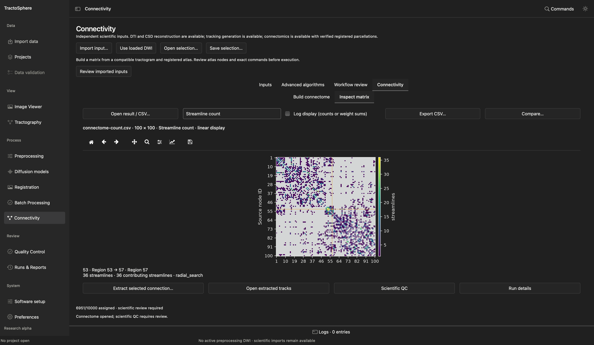

# SIFT2 weights and structural connectivity

SIFT2 and a connectome use **existing** streamlines. They do not create anatomical validity. Begin with a tractogram whose exact source FOD, subject, coordinate space and processing path are known. Save all outputs in new attempt directories.

## Compute SIFT2 weights

*The source tractogram and WM FOD must belong to the same reconstruction path. Select the mask policy, preview the exact command and inspect the saved factor QC after the run.*

1. Open the dedicated **SIFT2** task in the scientific workspace. Select the **Source tractogram**, **Compatible WM FOD** and **Reviewed reference**. The tractogram must be associated with that exact FOD; equal geometry is not enough.
2. Choose a **Processing mask policy**: **Explicit processing mask**, **ACT-derived processing mask**, or **Native whole-FOD model**. Supply a matching mask for the first policy or an accepted exact 5TT for ACT. Do not select ACT simply to bypass a mask blocker.
3. Leave advanced optimization values at native defaults unless you have a protocol. The panel exposes regularization, iteration bounds, density thresholds, optimizer coefficient/factor bounds, threads and optional heuristic GM scaling. GM scaling has extra single-tissue/ACT requirements.
4. Choose a new output directory, click **Preview commands**, check the exact files, policy, `tcksift2` command and resource limits, then approve and **Run approved SIFT2**.
5. Open the weight result, inspect the histogram and an original **Source index (0 based)**, and use **Scientific QC** / **Inspect weighted streamlines**. The factor count should correspond to the source tractogram. Nonnegative finite factors or optimizer convergence alone do not establish biological reliability. SIFT2 factors are not literal axon counts.

## Build a connectome

**A connectome is a square table.** Each row and column is one atlas parcel. A cell records a chosen measurement for streamlines whose endpoints were assigned to that pair of parcels. The atlas ID and the assignment rule determine what the cell means.

### Files to prepare

| GUI field | File to select | When it is needed |
| --- | --- | --- |
| **Tractogram** | The complete, reviewed `.tck` from the chosen tractography run | Every connectome. Keep its exact source identity and processing record. |
| **Registered parcellation** | A 3D integer-label `.nii` or `.nii.gz` registered to this participant's diffusion space | Every connectome. Keep the registration QC bundle and reviewer decision for this exact atlas/reference pair. Parcel IDs become matrix row/column IDs. |
| **Anatomical / FA reference** | A verified image in the tractogram's coordinate space, commonly a mean low-b `.nii.gz` | Every connectome. This anchors the source/atlas association; it is not an implicit registration step. |
| **FA sampling image** | An FA `.nii.gz` produced for the same participant and declared as metric **FA** at import | Required for **Mean FA** and **SIFT2-weighted mean FA**; omit for count-only or length-only runs. |
| **SIFT2 weight factors** | The exact-source `sift2-weights.txt` **with its binding record** from the SIFT2 run | Required for weighted metrics. A bare text vector with the same number of rows is insufficient. |
| **New output directory** | An unused local derivative folder | Every run. Leave the inputs and prior attempts untouched. |

The public-data example below uses a 10,000-streamline `.tck`, a 100-parcel registered Schaefer atlas, its matching mean low-b reference, an FA map and exact-source SIFT2 factors. The screenshot shows the **current Connectivity → Build connectome** screen with those real inputs selected.

*The node table shows 100 nonempty parcels and preserves their original integer IDs. This imported atlas did not carry a matching label-name sidecar, so the table displays generic names such as “Region 1”; do not infer parcel names from those placeholders. When supplying a label table, verify that its IDs and atlas version match the registered image.*

### Click through the GUI

1. Open **Connectivity → Build connectome**. If a file is absent from a drop-down, use **Import…** beside that field. Import the tractogram, then the registered parcellation and reference; add FA and weights only if your selected metric needs them. At import, declare the subject, session, space, metric identity and source provenance accurately. A filename alone does not establish them.
2. Select the **Tractogram**, **Registered parcellation** and **Anatomical / FA reference**. Check that all three belong to the same participant and approved coordinate relationship. If the atlas lacks accepted registration QC, click **Review atlas registration…**, inspect the existing exact atlas/reference QC, and complete [that GUI workflow](anatomy-registration.md#reuse-an-already-registered-atlas). Return to Connectivity and reselect the reviewed atlas if needed.
3. Inspect the **node table** before running: original parcel ID, label, voxel count and **Present** status. A missing parcel keeps its row/column position; later IDs are not silently renumbered. Verify the atlas version and any label-name sidecar rather than trusting generic fallback names.
4. Choose **Metrics**. The basic group computes **Streamline count**, **Mean length** and **Mean FA**; **All six metrics** also needs the exact SIFT2 factors and computes the three weighted variants. Or choose a single named metric to require only its inputs. Selecting an FA metric exposes the FA field; selecting a weighted metric exposes the weights field.
5. Choose **Assignment strategy**. **Radial endpoint search** looks around each track endpoint within the displayed radius; **Endpoint voxel lookup** uses the endpoint voxel; **Reverse inward search** and **Forward outward search** use the displayed distance limit. These choices can change which tracks are assigned. Set the radius or limit in millimeters for your protocol. In the shown public run, radial search used **4 mm**.
6. Open **Advanced matrix policies**. Decide whether to **mirror off-diagonal edges** and **zero the diagonal**; self assignments still appear in QC when the diagonal is zeroed. Set the number of threads. Record these choices with the result.
7. Choose a **new local output directory**. Click **Preview commands**. Read the exact tractogram/atlas/reference hashes, node IDs, FA and weight associations, assignment rule, output policies, tool path and `tck2connectome` commands. If preview blocks, follow its evidence message; a visually overlapping atlas or an equal grid cannot replace the required review record.
8. Check **I reviewed these exact commands, source geometry and scientific limitations**, then click **Build connectome**. Wait for the run to finish. The original tractogram and atlas remain unchanged. A completed numerical run can still require scientific QC review.
9. Open **Inspect matrix**. Choose the metric in the drop-down and click a cell. Read the source and target parcel IDs, edge value, contributing streamlines and assignment policy. **Log display** changes only the plot scale for counts or weight sums. Use **Scientific QC** and **Run details** to inspect assignment loss, missing nodes, empty edges, warnings, commands and input hashes.
10. Use **Open result / CSV…** to reopen the saved **connectome bundle JSON** with its node mapping and QC. **Export CSV…** makes a matrix copy; a CSV opened by itself needs its original atlas and row mapping declared. **Compare…** examines compatible matrices. **Extract selected connection…** writes a separate tractogram for the selected node pair; **Open extracted tracks** displays that output against the matching anatomy.

### See and interpret the generated matrix

*The saved public-data result is open in **Inspect matrix**. The selected row 53 → column 57 has a streamline-count value of 36 under radial endpoint search. The run assigned 6,951 of the 10,000 source streamlines and retained all 100 atlas rows; scientific QC still requires review. The plot is a measurement table, not a picture of individual axons.*

The run folder contains the bundle `connectome-connectome.json`, separate matrix CSVs for the selected metrics, an occupancy CSV, assignment records, `manifest.json`, logs and a QC report. For **All six metrics**, the matrix files cover count, mean length, mean FA, SIFT2-weighted contribution, SIFT2-weighted mean length and SIFT2-weighted mean FA. Keep the bundle and its associated files together so the GUI can verify and reopen them. An empty edge can have an undefined mean even when a CSV contains `0`; use occupancy and QC to distinguish it from a measured zero.

The illustrated 10,000-track run used preview-scale non-ACT tractography and carried a tensor-QC warning. Its technical and numerical checks completed, but the biological interpretation remains a review decision. Current connectome assignment verification is bounded to **1,000,000 source streamlines**; loading a 10M tractogram in the Viewer does not make a 10M connectome run eligible.

| Metric | Meaning |
| --- | --- |
| Streamline count | Number of assigned streamlines under the chosen endpoint and diagonal policy |
| Mean length | Mean complete streamline length in mm |
| Mean FA | Mean of each contributing streamline's arc-length-weighted sampled FA |
| SIFT2-weighted contribution | Sum of native SIFT2 factors; no extra μ scaling |
| SIFT2-weighted mean length | Weight-normalized mean complete length |
| SIFT2-weighted mean FA | Weight-normalized mean streamline FA |

Read assignment loss, empty nodes, self-assignments, out-of-range FA samples and FOD/tractography warnings in **Scientific QC**. Counts are not axons, and a technically populated matrix is not a publication-ready biological connectome.
