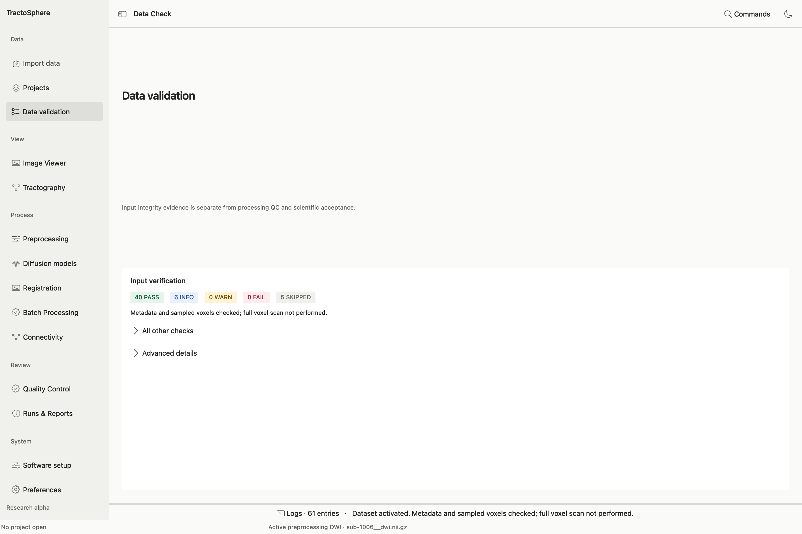

# Read the Data Validation report

After [loading a diffusion image with its matching gradients](import-projects.md#import-a-raw-or-already-processed-dwi), choose **Data validation** in the left sidebar. This page reopens the input report made during import; it does not perform a second correction or inspect a processing result. If it says **No input report available**, return to **Import data** and load the DWI first.

*A public DWI input has been loaded in the current GUI. Its 40 PASS, 6 INFO, 0 WARN, 0 FAIL and 5 SKIPPED findings describe input checks only. “Metadata and sampled voxels checked” means a full voxel scan was not performed.*

## Inspect each finding

1. Read the **PASS / INFO / WARN / FAIL / SKIPPED** totals and the coverage sentence. **SKIPPED** means that a check could not be performed or did not apply; it is not a pass. A zero FAIL count does not prove that a DWI is scientifically suitable for every task.
2. Any **FAIL** or **WARN** row appears before the other checks. Open its disclosure to read the observed value, expected value, suggested action, source and affected one-based volume indices when available. Correct the input association or retrieve the missing evidence; reload the exact dataset to generate a fresh report.
3. Open **All other checks** to see PASS, INFO and SKIPPED rows. For example, compare the number of image volumes with b-values and b-vectors, check the detected b-vector layout and review any metadata facts that the chosen correction requires.
4. Open **Advanced details** for the complete selectable JSON evidence. Keep this with your study record if you need to explain an import decision. Remove private paths and participant identifiers before sharing it.
5. Return to the intended task and read its *separate* eligibility message and command preview. A passed image/gradient integrity check does not provide phase encoding, readout time, reverse phase encoded calibration, processing history, atlas correspondence or a human QC review.

For a completed derivative, open its [Quality Control catalog](qc-runs.md#open-a-qc-catalog). That page shows stage figures, measurements and scientific review, while Data Validation shows the source import report.
