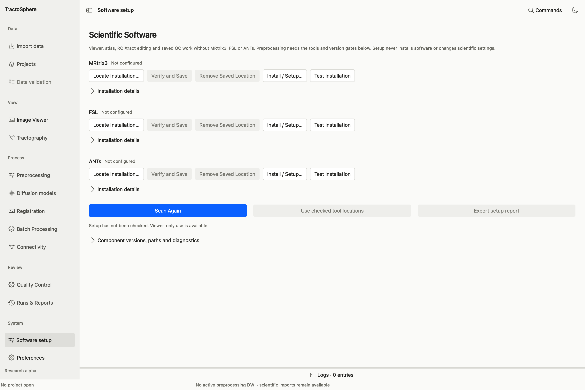
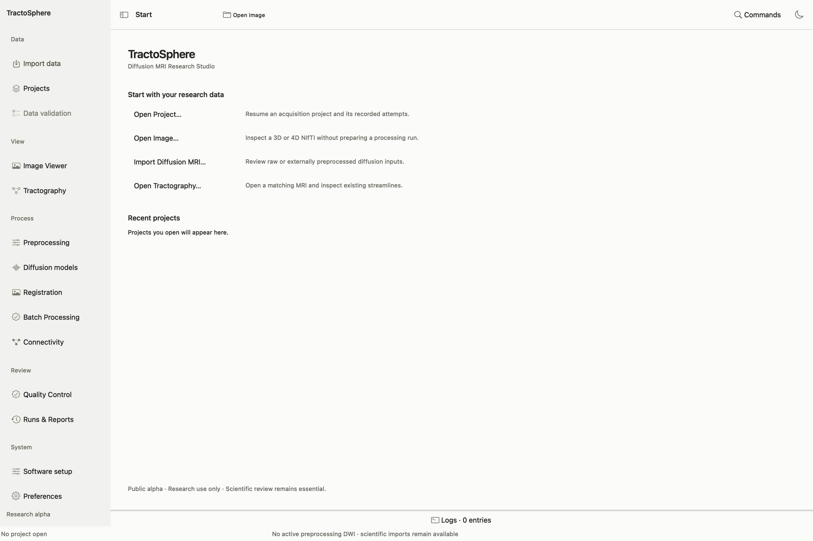
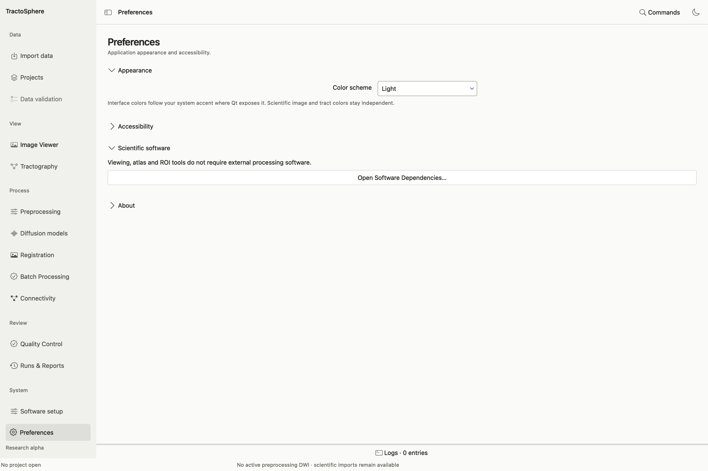

# Set up and open TractoSphere

New to diffusion MRI? Read [Diffusion MRI basics](dmri-basics.md) before choosing files. The screenshots on this site were captured from the native GUI in this local development checkout on 24 October 2026. Form screenshots without a selected participant show control placement; populated Data Validation, Viewer, QC and Runs examples use public data. They show how to inspect evidence, not a completed scientific review. If a packaged version has a different layout, check its version before following a control name.

## 1. Install the app

Follow the [installation guide](../installation.md) for your platform. The v0.2.1-alpha package and current source require Python 3.12 or newer. The primary native scientific GUI evidence is on Apple Silicon macOS; see [platform limits](../platforms.md) before relying on another platform.

For a source checkout of the current toolbox on macOS or Linux, run one command at a time in Terminal:

```sh
git clone https://github.com/kkartikeya-kulkarni/TractoSphere.git
cd TractoSphere
python3.12 -m venv .venv
source .venv/bin/activate
python -m pip install --upgrade pip
python -m pip install '.[gui]'
dmri-studio doctor
dmri-studio gui
```

The default `main` branch contains the GUI and guide shown here. The [installation guide](../installation.md) gives release and platform alternatives. If an already installed TractoSphere opens, you do not need to reinstall it for Viewer-only steps.

## 2. Make an output location

Create a local folder for **new derivatives**, with free space appropriate to the selected plan. Keep raw inputs in a separate folder. The app requires a new attempt directory for each processing run and will not overwrite an existing attempt. Keep source files, gradients, sidecars and producer records accessible; a saved project or workspace refers to them rather than bundling every array.

For large tractograms or FSL correction, use local or suitable high-performance storage. A cloud-synced placeholder that has not been downloaded locally is not a usable processing input. Download or stage the exact files first and confirm available space. A 10M-track plan may need substantially more space than the TCK alone because the plan reserves for intermediate and QC files.

## 3. Configure scientific software



*Software setup as a new user sees it. Start with the left sidebar, then locate and verify the package needed for your chosen task. A blank or unverified package is not ready for processing.*

1. Open **Software setup** in the left sidebar or **Preferences → Open Software Dependencies…**.
2. For each package you need, choose **Locate Installation…** and select its actual installation/bin folder. Use **Verify and Save**. The page covers MRtrix3, FSL and ANTs.
3. Select **Scan Again** if a tool was installed after the app opened. Read the reported executable and version, then choose **Use checked tool locations**. **Export setup report** saves a shareable setup summary; check it for private paths before sharing.
4. If you only need to view data, choose **Continue with viewer only**. Scientific processing remains unavailable until its required tools pass the operation-specific checks.

MRtrix3 supplies conversion, denoising, Gibbs correction, masks, tensor/CSD, tracking, SIFT2, 5TT and connectome commands. FSL supplies TOPUP/EDDY, anatomical extraction/segmentation and several registration routes. ANTs/N4 is needed for bias correction. The app does not install those programs automatically; **Install / Setup…** opens guided instructions. See [dependency setup](../dependency_setup.md) for folder examples and recovery steps.

## 4. Learn the workspaces



*The sidebar is the navigation map. Begin at Import data for a study, or Image Viewer if you only want to inspect an image.*

The sidebar contains **Import data**, **Projects**, **Data validation**, **Image Viewer**, **Tractography**, **Preprocessing**, **Diffusion models**, **Registration**, **Batch Processing**, **Connectivity**, **Quality Control**, **Runs & Reports**, **Software setup** and **Preferences**. Some scientific panels are reached through a task within a workspace; **Advanced** sections expose additional supported operations.

The Viewer opens images without running a processing step. Importing a file into the scientific inventory only checks and records its declared type, geometry and provenance. To compute a derivative, open the corresponding task, preview the command, and approve it. To judge anatomy, open the result and save a separate QC decision.



*Preferences changes appearance and offers a route back to software dependencies. It does not repair a missing DWI companion or approve an output.*

### Use every Preferences control

Open **Preferences** from the sidebar or **Edit → Preferences**. Under **Appearance → Color scheme**, choose **Follow system appearance**, **Light** or **Dark**; the choice changes application chrome, not image values or scientific color maps. **Accessibility → Suppress nonessential interface motion** is checked and currently disabled because this interface has no decorative animation. **Scientific software → Open Software Dependencies…** opens the same setup screen described above. Expand **About** for the product name and research-use notice. None of these choices edits source MRI files, registration transforms, tractograms or saved QC decisions.

## 5. Keep a reproducible study notebook

For each attempt, record the source filenames and checksums, subject/session/acquisition identity, processing history source, selected GUI options, new output directory, command preview, tool versions, final status, QC findings and reviewer decision. The saved run manifest supplies much of this; your scientific observations must be added by a human reviewer. Never edit original DWI, gradient or atlas files in place.
