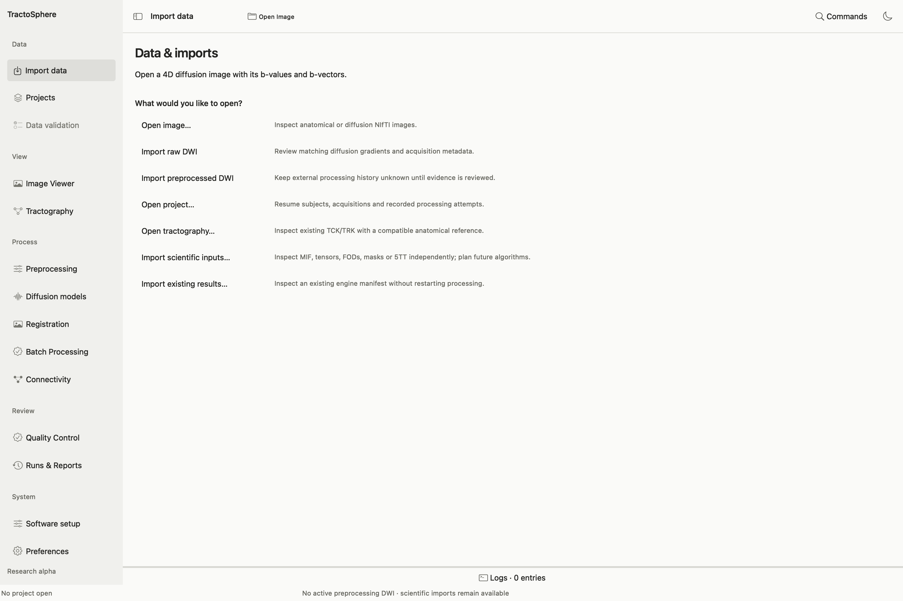
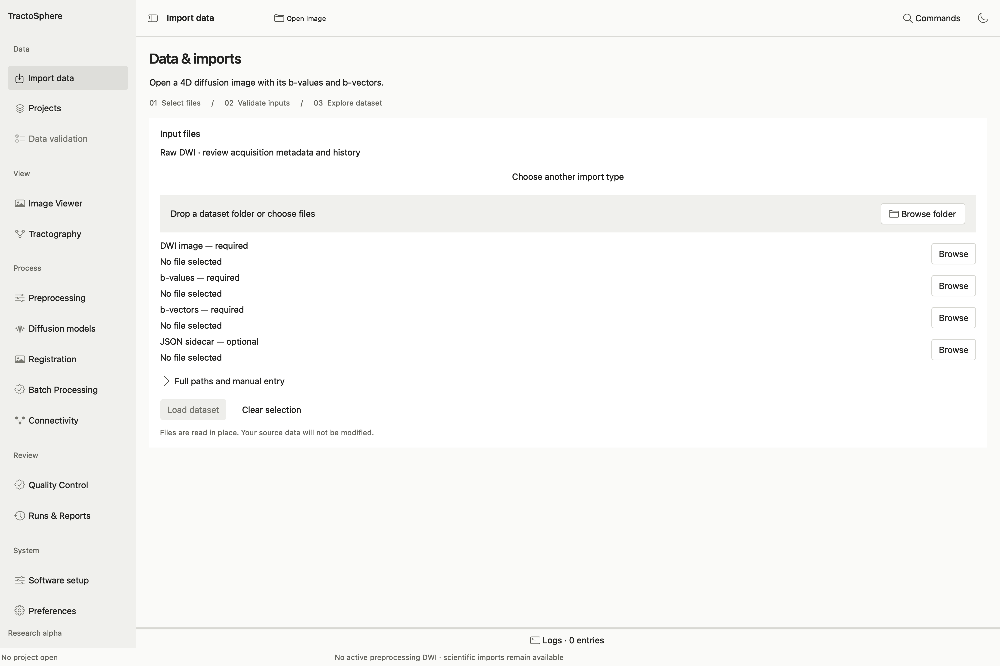
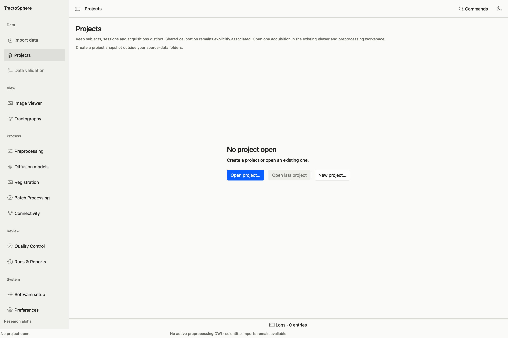

# Import data and organize projects

*Choose the kind of item you actually have. Raw DWI and preprocessed DWI are distinct choices; Image Viewer alone does not register a DWI for scientific tasks.*

## Import a raw or already processed DWI

*Fill the DWI image and its matching b-value and b-vector fields first. Add the matching JSON when available, read the validation text, then use Load dataset. A folder picker helps locate files but does not prove that companions match.*

1. Open **Import data**. Choose **Import raw DWI** for scanner-origin data or **Import preprocessed DWI** for a derivative. These choices describe the input; they do not prove its history.
2. Choose a dataset folder or browse for **DWI image — required**, **b-values — required** and **b-vectors — required**. Add the matching **JSON sidecar — optional** if present. A 4D DWI is `.nii`/`.nii.gz`; b-values are in s/mm², one per volume. b-vectors are FSL 3×N rows or N×3 columns. Do not pair raw b-vectors with a motion-corrected image unless they remain the verified companions for that derivative.
3. If exactly three volumes make the table layout ambiguous, select the supplied b-vector layout. Read any file-level errors before **Load dataset**.
4. Select **Load dataset**. The app reads the files in place, checks image/gradient associations, and displays volume counts, b-value groups, acquisition metadata and source paths. Open **Data validation** for detailed findings. Loading is not permission to start a correction with absent phase-encoding/readout metadata.
5. For a preprocessed file, open **Preprocessing** and review its history separately. Choose **Unknown**, **Not done**, **Completed** or **Conflicting evidence** for each stage based on actual records. A filename such as `eddy_corrected` is not enough to claim EDDY completed.

If you want to inspect only an anatomical image, choose **Open image…**. To inspect an existing TCK/TRK, choose **Open tractography…** and pair it with a reference from the same verified coordinate system. **Import existing results…** opens a saved run manifest without repeating its commands.

## Put an existing input in the scientific inventory

The Viewer/Import data screen and the typed scientific inventory serve different purposes. If a processing task says its dropdown is empty, open **Import scientific inputs…** or that task's **Import…** button; a visible image alone may not have a scientific type declaration.

1. In **Import scientific input**, choose the actual **Input type**: DWI, anatomy, mask, tensor, FOD, response, tractogram, atlas labels, 5TT, transform, streamline weights, or the relevant derivative type.
2. Choose **Input file**. For DWI also choose its matching **b-values**, **b-vectors** and any acquisition/provenance JSON. The dialog can suggest companions; verify every suggestion.
3. Enter the correct **Processing state**, **Subject identity**, **Space association** and **Provenance statement**. In **Scientific identity and format declarations**, add only evidence the file truly has: space kind/session/acquisition, DWI history, modality, tensor layout and frame, FOD basis/tissue, 5TT channel order, transform record, atlas manifest or QC association, and exact review files as required.
4. Complete the import and confirm the item appears in the shared inventory. If an operation still rejects it, read that task's blocker. Do not change the subject or space label merely to make two files look compatible; register or document the actual relationship.

**Example:** to use an already registered Schaefer atlas, import its discrete-label NIfTI as **atlas labels**, attach the verified producer **atlas registration run manifest JSON** when available, import the exact verified low-b reference, then use [Review an Existing Registered Atlas](anatomy-registration.md#reuse-an-already-registered-atlas). A matching voxel grid alone is not enough.

## Projects and BIDS discovery

*New project creates a place to organize acquisitions and attempts. Open project resumes an existing one. Neither button transforms the source DWI.*

Use **Projects → New project** to make a study container, **Open project** or **Open last project** to return to one, and **Import BIDS acquisitions** to scan a BIDS root. Discovery lists subjects, sessions and acquisitions; it does not silently combine AP/PA runs or accept their scientific suitability. Select an acquisition and **Load selected acquisition** to activate it. **Add loaded input** associates the current file with the project. **Attach attempt** associates a completed run; **Open attempt & QC** reopens its saved evidence.

For a BIDS dataset, keep `dataset_description.json`, the participant's `dwi/` files and inherited JSON metadata together. Verify that a discovered DWI's bval/bvec/JSON refer to that acquisition. If a BIDS sidecar is missing or contradictory, correct the source dataset or supply a defensible custom mapping; the app should not guess phase encoding or readout time.

## Move from import to a task

After import, select **Preprocessing** for raw/partially processed DWI, **Diffusion models** for tensor/FOD, **Registration** for low-b/T1/atlas work, **Tractography** for generating/filtering/mapping tracks, or **Connectivity** for matrices. In each task, choose the input from its own dropdown and confirm its subject, space and history before preview. Existing verified outputs can be reimported for a later task; keep their producer manifests so the next task can establish provenance.
