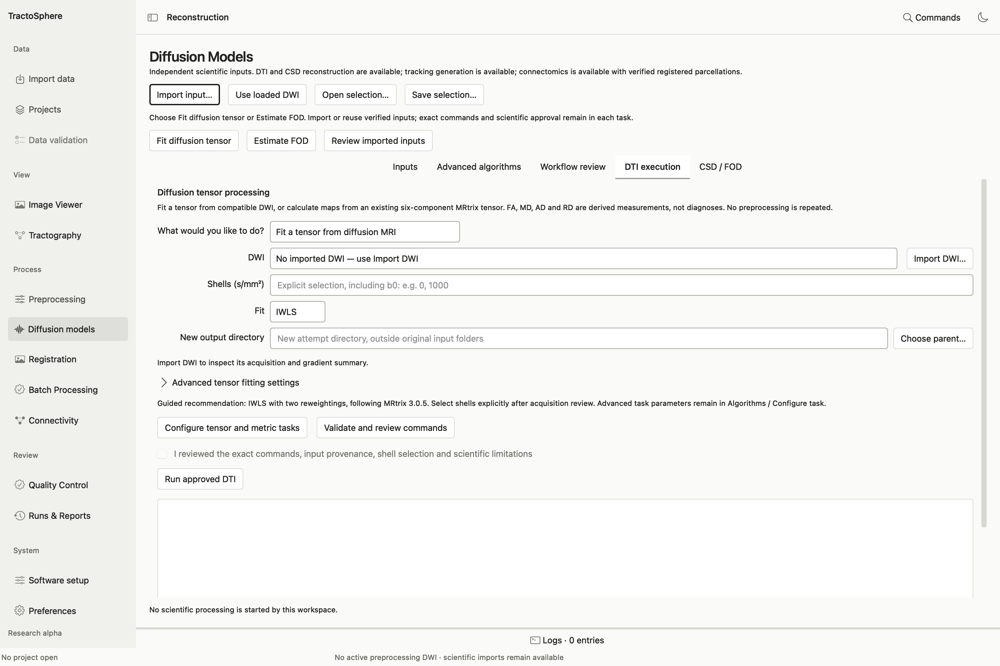
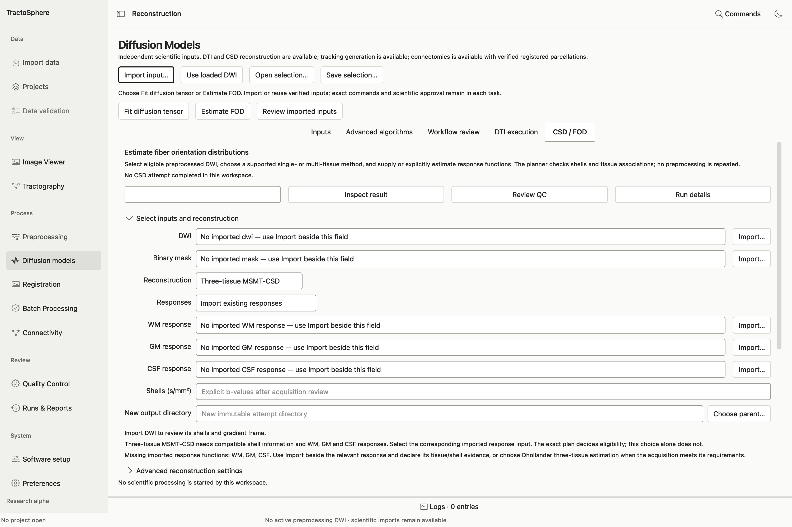

# Fit diffusion tensor and FOD models

Open **Diffusion models** after importing an eligible DWI with matching gradients. Preprocessing is **not** repeated by these panels. Inspect shells, masks and source history first; the GUI may block a task that has no defensible shell or fitting domain.

## DTI: fit tensor, then obtain FA and other maps

*The tensor task asks for the exact diffusion input and fitting choices. Review shells and optional mask before previewing commands. The run control remains unavailable until a valid plan is approved.*

1. Choose **Diffusion tensor processing → Fit a tensor from diffusion MRI**. Select or **Import DWI…**. Its bval/bvec must match the exact selected 4D image.
2. Enter **Shells (s/mm²)** explicitly, including b0; for example, `0, 1000` only when those shells are present and scientifically suitable. Choose **IWLS**, **WLS** or **OLS**. Advanced controls include the number of IWLS reweightings, an optional compatible **binary mask**, and threads.
3. Choose a **New output directory**. Use the panel's preview to validate the tensor fit and map commands. Read any fitting-mask or nonpositive-signal blocker. If a mask excludes an invalid fitting region, document the reason; do not silently substitute a different mask.
4. Approve the exact plan and run. Inspect the saved six-component tensor and FA, MD, AD, RD, principal eigenvector and eigenvalue maps. Open each map in the Viewer; check scale, brain coverage and unexpected values. Open **Review QC** and **Run details**.

To calculate maps from an existing tensor without refitting the DWI, choose **Calculate maps from an existing tensor** and **Import tensor…**. Declare its actual six-component order, coordinate frame and units during import. A FSL-layout tensor is not interchangeable with MRtrix layout without a verified conversion.

**Interpretation:** FA is dimensionless and normally evaluated with physical bounds; MD/AD/RD have diffusivity units. A successful tensor command does not remove negative eigenvalues, FA above 1 or low-signal findings. The audit's real DTI run retained such flags for scientific review; the guide does not call that output accepted.

## CSD: estimate response and WM FOD

*The CSD task separates model choice from response and mask sources. A WM response belongs to a particular DWI/model; selecting an arbitrary file with a similar name is unsafe.*

1. In **Estimate fiber orientation distributions**, choose **Single-tissue CSD** for a suitable single-tissue acquisition or **Three-tissue MSMT-CSD** only when the DWI actually supports the required shell/tissue model.
2. Select the exact **DWI** and **Binary mask**. Enter the shell b-values explicitly. Select **Responses**: import existing response file(s), or choose a supported estimator such as Dhollander, Tournier (WM only) or Tax (WM only). For MSMT-CSD, provide/estimate WM, GM and CSF responses as required; a WM-only response cannot stand in for the other tissues.
3. Under **Advanced reconstruction settings**, review WM `lmax`, threads and optional separate normalization. Normalization is not added by default.
4. Choose a new output directory, select **Validate and review commands**, and inspect the exact response/FOD plan. Approve and choose **Run approved CSD** only if input shells and response associations pass.
5. Use **Inspect result**, Viewer FOD glyphs, **Review QC** and **Run details** to examine coefficients, spatial coverage and any negative-amplitude/nonpositive-signal findings. The saved WM FOD is the exact source needed for later FOD tracking and SIFT2; retain its producer record.

**Response file caution:** a response estimated from one acquisition is not automatically valid for another subject or processing stage. The import and planner use explicit source identity. An FOD that is technically valid may still need specialist review before tractography or biological interpretation.
