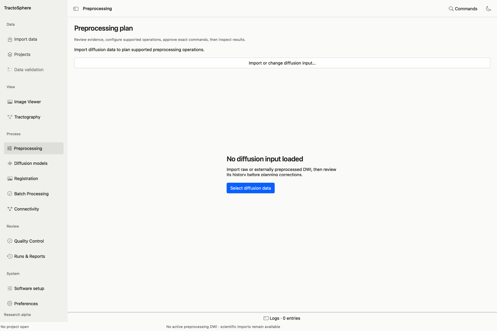

# Preprocess diffusion MRI

*This is the empty state. Click Import or change diffusion input or Select diffusion data. After a DWI loads, the history, operations and proposal sections appear; follow them in order.*

This page describes the GUI path from raw DWI to eligible derivatives, and how to run **one isolated operation** on a suitable partly processed input. The exact order depends on acquisition evidence and the selected plan; there is no universal button that makes an arbitrary file eligible for all stages.

## Before selecting an operation

1. [Import](import-projects.md) the 4D DWI and its exact bval/bvec. Add its BIDS JSON or other acquisition record when available.
2. Open **Preprocessing**. If no input is active, select **Import or change diffusion input…**. Check the file and gradient summary.
3. In **1 · Confirm processing history**, choose **Custom / unknown history**, **Raw acquisition — review**, or another template only as a starting point. For susceptibility, eddy-current, motion, gradient nonlinearity, denoising, Gibbs, interpolation/smoothing and bias correction, set the observed state to **Unknown**, **Not done**, **Completed** or **Conflicting evidence**. Give the **History source / explanation** and confidence, then click **Confirm history**. A template is not evidence by itself.
4. In **2 · Select individual operations**, select what you actually want. Read its **Requirements and method guidance** and any eligibility reason. Conversion to MRtrix may be inserted when required.
5. In **3 · Review proposal**, inspect the proposed order and blocked steps. Move to the execution controls, choose a **new** output directory, and use **Prepare command preview**. Read exact commands, files, tool versions, threads and limitations. Export the plan if desired. Use **Approve displayed plan and run** only for the preview you just inspected.
6. Watch the real progress/log. **Cancel** requests cancellation; partial evidence can remain in the attempt directory. After completion, use **Open generated step QC**, **Open saved run and outputs**, and the Viewer. A completed command may still need mask/anatomical review.

## Available operations and required inputs

| GUI operation | Extra files or evidence | Result to inspect |
| --- | --- | --- |
| **Convert to MRtrix and embed gradients** | Exact DWI+bval+bvec; gradient convention confirmed | New MRtrix image with embedded gradients; source unchanged |
| **MP-PCA denoising** | Raw or otherwise eligible un-interpolated DWI; history showing suitability | Denoised derivative and noise/residual QC |
| **Gibbs ringing removal** | Suitable image and slice-axis/partial-Fourier history | `mrdegibbs` derivative and actual axis/method in command preview |
| **Generate brain mask** | Compatible DWI | Binary mask, coverage view and separate mask review |
| **TOPUP and EDDY correction with diagnostic gate** | Associated opposite phase-encoded low-b magnitude images, PE direction/readout/slice/acquisition metadata, FSL; producer record if input is a prior derivative | Corrected DWI and rotated gradients, fitting/final masks, EDDY/TOPUP diagnostics, gate record |
| **N4 bias correction after verified EDDY** | Direct EDDY output and rotated gradients, explicit fitting mask, validated EDDY record JSON, passing correction gate JSON, ANTs | Bias-corrected DWI and field; check mask/field/signal QC |
| **Prepare anatomy and white-matter candidate for review** | T1 and route-specific structural preparation history/inputs | Extracted T1, candidate tissue masks and anatomical QC |
| **Align mean low-b to reviewed T1** | Verified low-b and structurally reviewed T1 evidence | Transform/registered image plus separate three-plane QC |
| **Optional verified AP/PA combined derivative** | Fully matched AP and PA diffusion acquisitions with verified pairing, not merely a PA b0 | Separate combined derivative and provenance |

## A raw-DWI example sequence

1. Import the raw DWI and confirm its gradients and JSON. Record that no earlier correction is known; do not mark stages completed without evidence.
2. Select **MP-PCA denoising** if the acquisition and interpolation history permit it. Preview and run into a new directory. Inspect noise/residual evidence; use the saved DWI and its appropriate gradients for the next attempt.
3. Select **Gibbs ringing removal** on the eligible derivative. The preview should show `mrdegibbs` and the chosen axes. If partial-Fourier/slice-axis evidence makes the standard method unsuitable, stop and resolve that finding instead of forcing the step.
4. For susceptibility/motion correction, select **TOPUP and EDDY**. Under **TOPUP/EDDY acquisition and calibration evidence**, add the associated reverse-PE b0 images, BIDS root if useful, and native producer JSON for a derived input. Ensure actual PE/readout/slice facts are present. Preview the exact TOPUP/BET/EDDY/gradient conversion/mask steps, then run only when the plan is eligible. Inspect outliers, motion, CNR/residual diagnostics, masks and the saved gate before using the output.
5. If eligible, select **N4** on the **direct** EDDY derivative. Under **N4 fitting mask and upstream evidence**, provide the fitting mask, validated EDDY record and passing gate. Preview, run and inspect the field and corrected DWI. Do not repeat N4 on an already bias-corrected image.
6. Import the final DWI with its **final corrected gradients** into the scientific inventory. Use it for [DTI/CSD](models.md) only after reviewing their own input/mask requirements.

## Run only one step on a partly processed dataset

Import that exact derivative and its companion gradients. In history, mark each prior stage **Completed** only when its producer log/manifest supports it; use **Unknown** when records are absent. Select just denoising, just Gibbs, a mask, or another eligible operation. The planner may refuse denoising after interpolation, correction without acquisition metadata, or N4 without the direct EDDY handoff. A refusal is a meaningful safety result, not a reason to invent history. Preserve the original derivative and place the new output in its own attempt folder.

## Mask and correction review

For a generated mask, use **Inspect mask on original DWI**, examine axial/coronal/sagittal coverage and choose **Accept mask** or **Reject mask** with actual observations. Correction QC is more than command exit status: examine PE direction, b0 alignment, outlier replacement, motion, residual/CNR behavior, final mask and gradient association. Record unresolved findings as pending or rejected. See [QC and saved runs](qc-runs.md).
