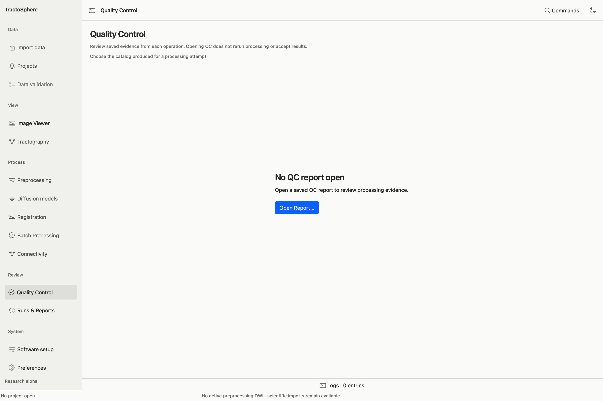
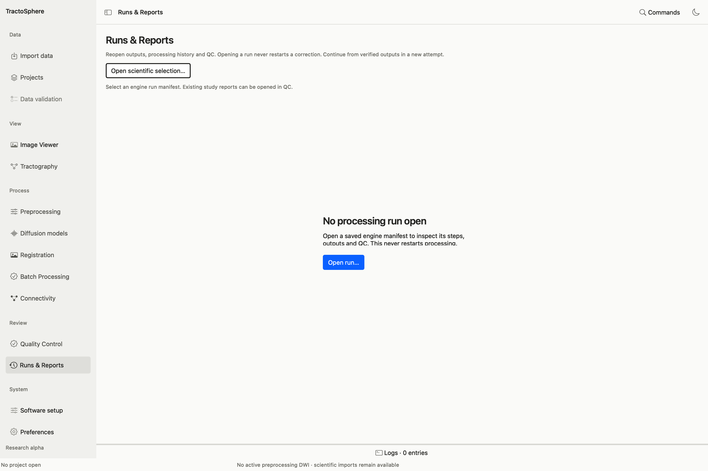

# Review quality control and saved runs

Every processing attempt produces a **new output directory** containing an exact plan, execution manifest, logs, products and usually a QC catalog/report. A status such as `validated_pending_qc` means execution and technical checks reached a validated state while scientific assessment remains separate.

## Open a QC catalog

*Choose Open Report to load the QC record saved by a specific processing attempt. The empty screen contains no review decision.*

1. Choose **Quality Control → Open Report…** and select the saved producer QC catalog/report (usually `qc-catalog.json` or a report within its attempt directory). Opening an arbitrary image is not equivalent to opening its QC evidence.
2. Select a stage and inspect **Figures**, **Measurements** and **Source details**. Enlarge a figure to its native pixels, inspect all available planes/maps, and read warnings as well as passes. **Compare images** can help inspect source vs derivative. **Open report** and **Export report** are for review copies; do not remove original evidence.
3. Under **Scientific review**, enter the actual reviewer name, choose **needs_review**, **accepted** or **rejected**, and write a reason describing observed coverage, artifacts and remaining uncertainty. Use **Record review…** to save a new review; **Open saved review…** retrieves it. Do not choose accepted simply because a command succeeded.
4. For atlas registration, use its supported saved QC bundle and Viewer in axial, sagittal and coronal planes before recording an anatomical decision. For 5TT, inspect the exact cortical GM/WM/CSF compartments and bind the decision to the exact five-tissue image. The separate anatomical alignment and tissue-boundary decisions are different records.

## Open Runs & Reports

*Choose Open run to inspect a saved manifest and its outputs. Opening the run does not restart processing or approve its scientific result.*

Use **Runs & Reports** to reopen an existing manifest, verify product/source hashes, inspect each recorded step and its tool/parameter identity, view outputs or launch QC without rerunning the command. A missing or changed file should be investigated; do not edit an immutable run record to hide a mismatch. **Projects → Open attempt & QC** and task-specific **Run details** lead to the same saved evidence from their contexts.

## What to record for a scientific decision

| Item | Example question for the reviewer |
| --- | --- |
| Source association | Are subject, session, acquisition, gradients and reference the intended ones? |
| Spatial correspondence | Do brain, T1, atlas, ROIs, FOD and tracts align in all relevant planes? |
| Processing artifacts | Are masks, distortion correction, motion/outliers, signal and model maps plausible? |
| Numerical findings | Are invalid/negative/nonfinite/out-of-range values understood, not silently clipped? |
| Scope | Is this a diagnostic demonstration, a bounded technical test or an accepted analysis? |
| Decision | Who reviewed the exact file/hash, when, in which views, with what observations and limitations? |

If the reviewer changes a decision later, save a new record that identifies the same or new exact evidence. A changed image hash requires a new assessment. Never attach a prior accepted record to a different derivative just because names or dimensions match.
