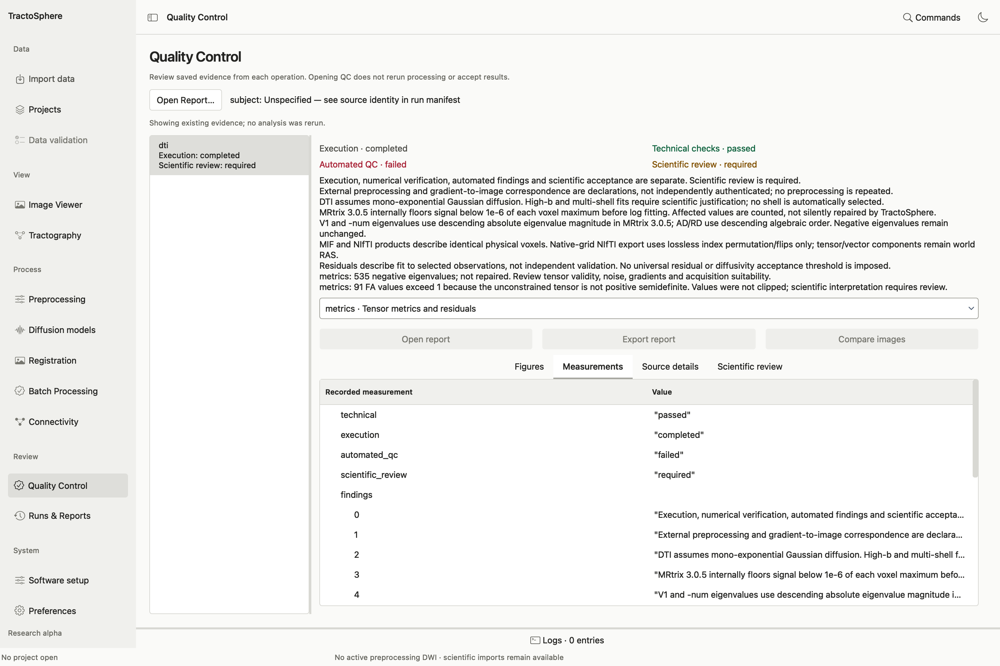
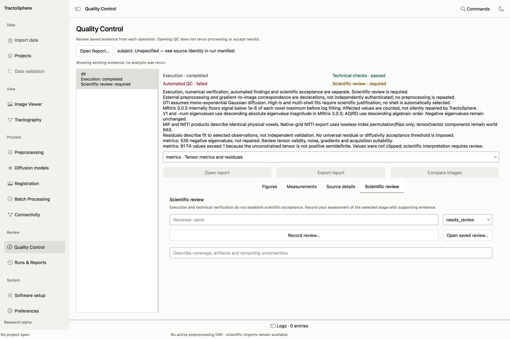
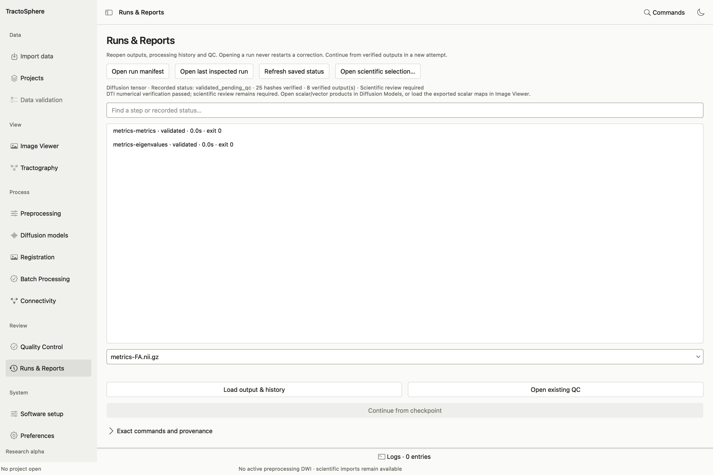

# Review quality control and saved runs

Every processing attempt produces a **new output directory** containing an exact plan, execution manifest, logs, products and usually a QC catalog/report. A status such as `validated_pending_qc` means execution and technical checks reached a validated state while scientific assessment remains separate.

## Open a QC catalog

*This is a real populated QC screen from the public CC0 sub-1006 example. The left column selects the DTI stage. The four labels at the top show separate states: execution completed, technical checks passed, automated QC failed, and scientific review still required. The failure includes negative tensor eigenvalues and FA values above one; the app did not repair or accept them. The Measurements tab shows recorded values from the producer rather than recalculating them.*

1. Choose **Quality Control → Open Report…** and select the saved producer QC catalog/report (usually `qc-catalog.json` or a report within its attempt directory). Opening an arbitrary image is not equivalent to opening its QC evidence.
2. Select a stage and inspect **Figures**, **Measurements** and **Source details**. Enlarge a figure to its native pixels, inspect all available planes/maps, and read warnings as well as passes. **Compare images** can help inspect source vs derivative. **Open report** and **Export report** are for review copies; do not remove original evidence.
3. Under **Scientific review**, enter the actual reviewer name, choose **needs_review**, **accepted** or **rejected**, and write a reason describing observed coverage, artifacts and remaining uncertainty. Use **Record review…** to save a new review; **Open saved review…** retrieves it. Do not choose accepted simply because a command succeeded.
4. For atlas registration, use its supported saved QC bundle and Viewer in axial, sagittal and coronal planes before recording an anatomical decision. For 5TT, inspect the exact cortical GM/WM/CSF compartments and bind the decision to the exact five-tissue image. The separate anatomical alignment and tissue-boundary decisions are different records.

### Read the populated QC screen

1. **Open Report…** chooses the `qc-catalog.json` saved in one attempt directory. Wait for the hash check to finish. A changed or missing artifact is an error; return to the original attempt rather than ignoring the mismatch.
2. **Stage list** on the left selects one processing step. The state labels on the right are independent: a command can finish while automated findings fail and review is still pending, as in the screenshot.
3. **Findings** give the producer's specific warnings and limitations. Read all of them before viewing a single image or metric.
4. **Evidence selector** chooses a saved figure, metrics JSON, report or comparison. **Figures** fits or zooms a saved image; **Measurements** exposes values as a tree; **Source details** shows the unchanged record and local path. The report buttons activate only for a report artifact. **Compare images** activates only when a suitable saved comparison is available.
5. **Scientific review** is a separate tab. Enter the reviewer name, choose `needs_review`, `accepted` or `rejected`, and write observations about the exact result. Use **Record review…** to save the decision or **Open saved review…** to reopen one. Do not choose `accepted` because the technical label is green.

*The review tab has blank fields in this example: no scientific decision was fabricated for the public DTI result. An authorized reviewer must inspect the relevant evidence and enter their own rationale.*

## Open Runs & Reports

*A public DTI manifest is open: 25 hashes were verified, 8 outputs are listed, and scientific review is still required. The disabled checkpoint action indicates this completed attempt has no interrupted prefix to continue.*

1. Choose **Open run manifest** and select `manifest.json` inside the exact attempt folder. **Open last inspected run** returns to the previously inspected manifest; **Refresh saved status** reads it again if the producer has written more evidence. Opening a run does not restart it.
2. Wait for output and input hashes to be verified. The status line shows the recorded state, number of verified hashes and available products. A missing, altered or moved source can stop verification; restore or investigate the actual file instead of editing the manifest.
3. Search the **saved processing step states** list for a command or status. Read each step's completed/failed state, elapsed time and return code. Expand **Exact commands and provenance** to inspect command arguments, tool identity, input/output records and the producer's notices.
4. If verified outputs are listed, select one under **Verified diffusion outputs** and choose **Load output & history** to make that exact derivative the active input for a later stage. Review the associated processing history before planning a new command. **Open existing QC** opens the report saved for this attempt.
5. **Continue from checkpoint** appears only when the engine can verify a native successful prefix after failure or cancellation. It begins a **new attempt** from that derivative; read and approve the new plan. It does not modify or resume an external command from the middle of execution.

**Projects → Open attempt & QC** and task-specific **Run details** lead to saved evidence from their own contexts. A processed derivative may have a task-specific producer record as well as this general run view; follow the task's reported path and use the matching QC catalog. The scientific review remains separate from the saved command status.

## What to record for a scientific decision

| Item | Example question for the reviewer |
| --- | --- |
| Source association | Are subject, session, acquisition, gradients and reference the intended ones? |
| Spatial correspondence | Do brain, T1, atlas, ROIs, FOD and tracts align in all relevant planes? |
| Processing artifacts | Are masks, distortion correction, motion/outliers, signal and model maps plausible? |
| Numerical findings | Are invalid/negative/nonfinite/out-of-range values understood, not silently clipped? |
| Scope | Is this a diagnostic demonstration, a bounded technical test or an accepted analysis? |
| Decision | Who reviewed the exact file/hash, when, in which views, with what observations and limitations? |

If the reviewer changes a decision later, save a new record that identifies the same or new exact evidence. A changed image hash requires a new assessment. Never attach a prior accepted record to a different derivative just because names or dimensions match.
