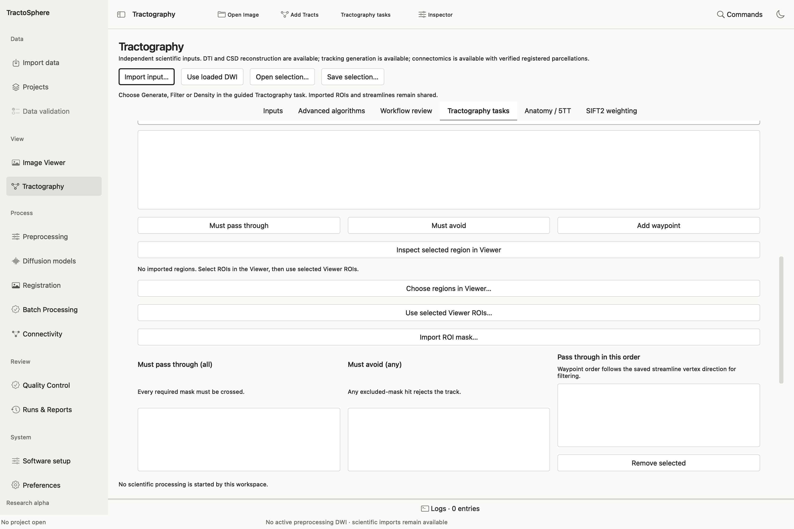

# Filter streamlines with two or three regions

**Filtering** keeps the paths from an existing tractogram that satisfy spatial rules. It does not generate new pathways. TractoSphere writes a **new `.tck`** and leaves the full source intact. The result depends on the source tracks, ROI masks, coordinates, inclusion rule and endpoint setting; changing any of those can change the answer.

## Gather the files first

| File | Where it comes from | What to verify |
| --- | --- | --- |
| Source tractogram `.tck` | A completed tractography run or an existing verified source | Exact participant, processing history and full source count. Guided MRtrix filtering accepts TCK. If you have TRK, use the reviewed full-source TRK-to-TCK action first. |
| Reference image `.nii`/`.nii.gz` | The anatomical image or diffusion reference associated with those tracks | Physical coordinate correspondence, subject/session and valid affine. Viewing an overlap alone does not prove correspondence. |
| Two or three binary ROI masks `.nii.gz` **or** one original discrete-label atlas | Imported individual ROI masks, Viewer ROI derivatives, or a registered atlas with exact integer parcel IDs | Same participant and verified spatial association. An edited ROI is a new derivative; an atlas must have its own registration evidence. |
| New output parent | Local folder outside the source folders | Enough free space for a new attempt and QC files. The task will not overwrite an existing attempt. |

For an atlas, a label image contains many integer parcels. Do not import the entire multi-label image as if it were one binary ROI. Select exact parcel IDs in the **original Viewer atlas** route, or export selected parcels as separate binary ROI derivatives and use the guided route.

## Route A: guided filter with individual ROI masks

1. Open **Tractography → Tractography tasks → Select or Filter Existing Streamlines**. If the task is not already selected, click that middle task button.
2. At **Filter existing tractogram**, choose or import the exact source TCK. At **Filter reference image**, choose or import its compatible reference. If the source is open in Viewer, select its tract group and use **Filter These Tracks…** to carry its **full file** into this form. If the input is a TRK, choose **Convert reviewed full-source TRK to TCK…** and verify the converted source before continuing.
3. Decide whether to check **Test endpoints only, instead of the full pathway**. Leave it unchecked to ask whether tracks pass through the masks anywhere along their saved paths. Check it only when the research question concerns actual streamline endpoints. Endpoint-only and ordered waypoints cannot be combined.
4. Decide whether to check **Limit the number of retained streamlines**. The **Maximum retained streamlines** number applies only when that checkbox is checked; a value visible in the field is not an active limit by itself.
5. Open **Choose pathway regions**. Select an imported mask from the searchable list. If none appears, choose **Import ROI mask…**, **Choose regions in Viewer…**, or **Use selected Viewer ROIs…**. Viewer selections become reviewed snapshots for the processing task; display color or visibility does not define a processing rule.

6. With a mask selected, click **Must pass through**, **Must avoid**, or **Add waypoint**. Repeat for each ROI. Read the three lists below the buttons to verify each mask landed in the intended role. **Remove selected** removes one assignment. For waypoints, **Move up/Move down** changes their required order.
7. Click **Inspect selected region in Viewer** when uncertain about location. Confirm it is the correct side, parcel and anatomical space. Then return to the filter task.
8. Scroll to **New output directory**, choose a fresh parent, and click **Validate and Preview Plan**. Read the source path/count, reference, ROI snapshots, `tckedit` arguments, length/endpoints/number settings, software location and any blocker. Changing a field invalidates this approval.
9. Check **I reviewed this exact plan, source association and scientific limitations**, then choose **Run Approved Plan**. Wait for completion. **Open Result in Viewer** shows the new TCK; **View Original Tracks** returns to the full source. Use **Review QC** for original and retained counts, ROI observations and warnings, and **View Run Details** for commands and hashes.

### What do two or three masks mean?

| Desired question | Example assignments | A retained streamline must… |
| --- | --- | --- |
| Cross two regions | ROI A and ROI B both **Must pass through** | Visit both masks, in either order |
| Cross three regions | ROI A, B and C all **Must pass through** | Visit all three masks |
| Cross A and B but avoid C | A/B **Must pass through**, C **Must avoid** | Visit A and B and never hit C |
| Travel through A, then B, then C | A/B/C **Add waypoint** in that order | Meet the waypoints in saved streamline vertex direction; reversing a streamline can affect the result |

The guided **Must pass through** list uses **ALL**, not “any one of these.” **Must avoid** uses **ANY**: one excluded-mask hit rejects the track. For “A **or** B,” use the original atlas route's **OR / Include ANY** rule when appropriate, or create and document a union ROI derivative rather than assuming guided ALL means OR.

## Route B: filter named parcels from the original Viewer atlas

Use this route when your starting regions are labels in one original registered atlas, such as three named parcels. First open the exact reference image and tractogram in **Tractography Viewer**, then load the original discrete-label atlas with its known label table. Select the relevant atlas regions and use **Filter using original Viewer atlas (Include ANY / ALL)…** from the guided filter task, or the Viewer's corresponding filter action. The dialog displays the **full source count** and original atlas path/IDs; it does not filter only the 10,000 tracks currently drawn.

1. Search the original atlas region list by **name or ID**. Assign selected regions to **Must pass through** or **Must avoid**. Check the included and excluded lists; an ID is only meaningful for this exact atlas version.
2. Choose **Inclusion rule**: **OR** means any included parcel, **AND** means all included parcels, and **ORDERED** means the listed parcels in saved vertex order. Use **Move up/Move down** to arrange ORDERED IDs. Optionally choose **Test endpoints only** for a different endpoint question; the app blocks its combination with ORDERED.
3. Provide the required subject/space and registration evidence if the dialog asks for it. A historical spatial declaration or equal image grids cannot substitute for native review of atlas-to-reference correspondence.
4. Choose an unused local output parent and **Preview command**. The plan creates exact binary mask snapshots from the original atlas labels and shows the full-source `tckedit` command. Inspect the rule, source, IDs, masks and free-space check; then mark the approval checkbox and **Run filter**.
5. After completion use **Open filtered tracks**, **Return to full tractogram**, **View QC**, **View run details**, and, if needed, **Save result as…** to export an unchanged verified TCK with its provenance. **Cancel job** requests cancellation. **Save configuration…/Load configuration…** preserve the selected rule; revalidate after reopening.

The native MRtrix filtering checks saved streamline vertices against ROI voxels. QC also records independent crossing observations, which may flag a path that crosses between saved vertices. Treat such findings as review items. Neither a nonzero retained count nor a visually plausible colored bundle proves a biological connection.

## Inspect the result over the brain

Open the same verified reference NIfTI first, then the filtered TCK. Choose **Four views** so axial, coronal, sagittal and 3D views are visible together. Select the filtered tract group in the Inspector; check the retained count and compare it with the full source. If the 3D panel shows tracks without a brain outline, open the intended NIfTI again and adjust **Volume rendering** or a suitable anatomical surface. Those display changes do not alter the filter. The **Display limit** may show only a subset in 3D; the processing plan and QC use the complete source file.

If zero tracks remain, check ROI location and source/reference identity, whether you accidentally chose ALL instead of ANY, whether endpoints-only or order was intended, and the QC's ROI observations. Do not enlarge or move a mask only to make a nonzero result without documenting a new scientific ROI decision.
