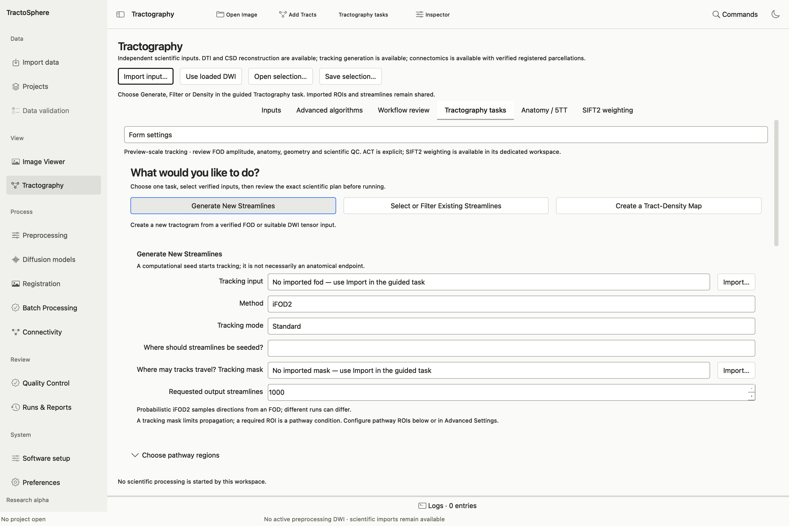
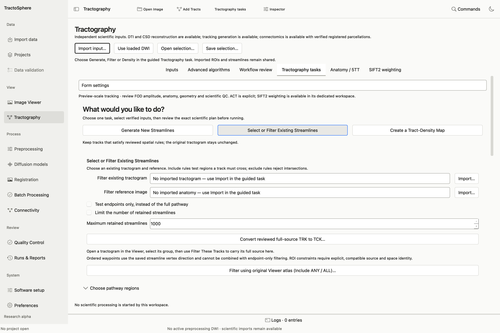
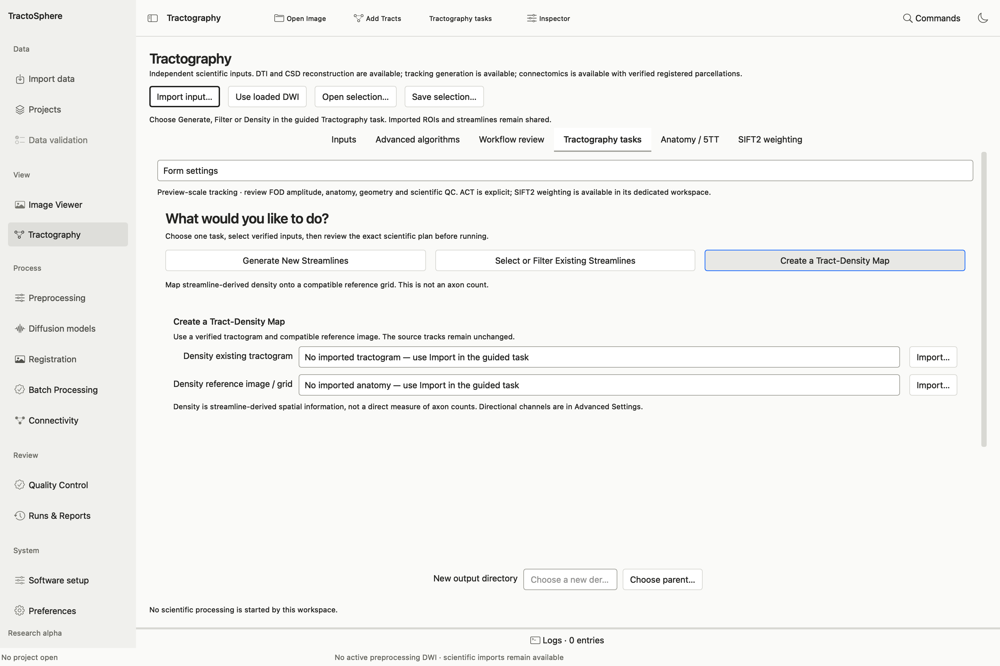

# Generate, filter and map streamlines

*Choose one of the three task buttons. The form below changes with that choice. For a first run, use a small requested count, inspect the plan and then open the result over the same reference image.*

Open **Tractography → Tractography tasks**. The task-first choices are **Generate New Streamlines**, **Select or Filter Existing Streamlines**, and **Create a Tract-Density Map**. The lower-level controls appear under the same task and use the same approved plan. Source images and tracks are not modified in place.

## Generate a bounded tractogram

1. Select **Generate New Streamlines**. For FOD tracking, select the exact WM FOD from [CSD](models.md), a compatible tracking mask and a seeding method. Standard methods include probabilistic iFOD2/iFOD1, deterministic SD_Stream and supported tensor tracking methods. Tensor methods use eligible DWI and explicit shells instead of a WM FOD.
2. Set **Tracking mode** to **Standard** or **Anatomically constrained (ACT)**. ACT needs the exact accepted 5TT; inspect its accepted tissue review first. ACT controls include backtracking for iFOD2 and optional cropping at the GM–WM interface. Choose **GM–WM interface (ACT)** seeding only when its reviewed seed derivative exists.
3. Choose **Seeding**: dynamic FOD, image mask, selected ROI, world-space sphere, random per voxel, grid per voxel or accepted GM–WM interface, according to method eligibility. When using an image/ROI, select its exact subject and space association. Select **Requested streamlines**; a small initial run (for example 2,000) is useful for a bounded operational check.
4. In advanced controls, inspect step size, angle, FOD cutoffs, minimum/maximum length, seed count and attempt limit. These affect path generation and resource usage. Do not use a 10M request as an initial smoke test; inspect disk estimate and scientific suitability first.
5. Choose a **new output directory**, click **Validate and Preview Plan**, read the actual `tckgen` command, input associations, storage estimate and limitations, then check **I reviewed this exact plan…** and **Run Approved Plan**.
6. Use **Open Result in Viewer**, **View Original Tracks**, **Review QC** and **View Run Details**. Check track count, lengths, locations, mask violations and implausible paths against anatomy. A requested count and numerical check are not anatomical approval.

## Filter existing tracks using ROIs

For a first-time, click-by-click explanation of **two or three ROI filtering**, including the difference between guided binary-mask filtering and original-atlas filtering, use [Filter tracks with ROIs](tract-filtering.md).

*Choose the source tractogram and compatible reference first. Use the endpoint checkbox only when the intended rule tests endpoints; otherwise use full-path ROI constraints under Choose pathway regions or the original Viewer atlas action. The maximum-retained field matters only when its checkbox is selected.*

1. Open the source TCK/TRK and its exact compatible reference in the [Viewer](viewer.md), or import them in the task. Select **Select or Filter Existing Streamlines**. The operation uses the **full source tractogram**, even when Viewer draws only a capped subset.
2. Add verified binary ROIs or select named regions from an original discrete atlas. For general ROI inputs, assign **Must pass through** (all selected), **Must avoid** (any hit removes the track), or **Pass through in this order**. Ordered waypoints follow saved streamline vertex direction. **Endpoints only** tests endpoints and cannot be combined with ordered waypoints.
3. For a Viewer atlas, choose **Filter using original Viewer atlas** and select named parcels. Choose **Include ANY** for a union, **Include ALL** for every chosen parcel, or **ORDERED** only when direction matters. Verify the atlas source grid and reference relationship. Edited ROI masks are separate derivatives and cannot masquerade as the original atlas.
4. Optionally set length limits and a maximum retained count. Choose a new output directory; preview `tckedit` and the ROI mask snapshots; approve and run.
5. Open the filtered result over the **same data image**. Inspect three-plane context and 3D fibers/ROI surfaces. The saved result is a new TCK, not merely a hidden Viewer subset. Read QC for original count, retained count, intersections and unchanged source hashes.

**Example of an audited GUI result:** a 10,000-track public tractogram was filtered through three right-hemisphere Schaefer visual parcels in **ALL, full-path** mode; 42 tracks were retained. This is a technical demonstration, not expert acceptance of those pathways. The exact parcel IDs were 52, 53 and 54 in that particular atlas; do not assume those IDs in a different atlas/version.

## Create a tract-density map

*The output grid comes from the selected reference image. Import the exact tractogram and compatible reference, then scroll to the new output directory and preview the plan.*

Select **Create a Tract-Density Map**, the existing tractogram and an exact compatible **Reference image**. Review map type/resolution/direction settings, choose a new output directory and preview the `tckmap` plan. Run, open the scalar or directional image in Viewer, and inspect geometry and units in QC. Density is a count/contribution of reconstructed streamlines under the selected mapping policy, **not** an axon count.

## Why the Viewer may show 10,000 from a 10M file

**Display limit** is a rendering cap. The indexed source can contain many more fibers. In **Tract groups → Appearance**, change the cap to render a larger subset if the workstation can support it; the GUI currently caps drawn fibers below ten million. Filtering, density and counts use the source file under their reviewed plans, not the visible subset. The user reported successfully loading an existing 10M TCK, but that is different from a verified 10M-generation run or drawing all ten million at once. [Viewer instructions](viewer.md) explain background image and 3D display controls.
