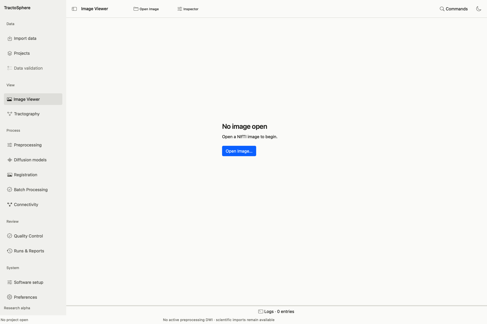
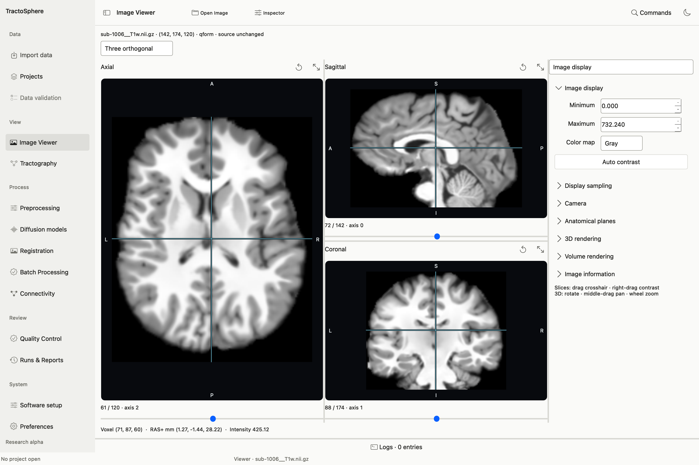

# View images, tractograms, atlases and ROIs

*A new user sees this empty Viewer. Select Open Image and choose a NIfTI first. The Inspector controls and slice views appear after the image loads.*

The Viewer is for inspection and display. An image opening successfully does not give it a processing history or make an atlas registered. For scientific tasks, import the corresponding typed input and evidence separately.

## Start with a reference image

*After opening a NIfTI, inspect axial, sagittal and coronal views. This example uses the public CC0 TractoInferno/OpenNeuro ds003900 sub-1006 T1; it is a display example, not a registration or tissue-QC decision. The panel on the right changes contrast and other display settings without changing the source image.*

1. Choose **Image Viewer → Open Image** (or **Import data → Open image…**) and select a valid 3D/4D `.nii`/`.nii.gz`. The title/status shows image name, shape and spatial transform source. A 4D image has a volume control.
2. Choose **Three orthogonal** or **Four views**. Axial, sagittal and coronal slice sliders move through the source image; click/drag the crosshair to relate a location across planes. Check left/right orientation and the displayed RAS+ millimeter coordinates before judging alignment.
3. In **Inspector → Image display**, set minimum/maximum intensity, gray or another color map and **Auto contrast**. These change display only. **Display sampling** changes display interpolation; it does not resample the source file.
4. In **Image overlays**, add a compatible scalar, label or segmentation image. Adjust the selected overlay's visibility, opacity, color map and range. If its grid differs, establish real world-space correspondence; a plausible screen overlap alone is insufficient.

## Add tractography and keep the brain visible

Open **Tractography** in the sidebar, keep the chosen reference image loaded and use **Add Tracts** to select `.tck` or `.trk`. Choose **Four views** to see the background image in three slices plus 3D tracks. The background image is the currently loaded NIfTI, which can be a mean b0, FA or registered T1. To return to an earlier data image, choose **Open Image** and select that exact NIfTI again; do not change the tract source. Check that both files share verified anatomical coordinates before interpreting overlay.

For a visible 3D brain outline, open **Inspector → Volume rendering** or a compatible surface/ROI overlay and adjust its visibility, threshold/opacity and camera. A low-contrast transparent isosurface may look nearly black; increasing opacity/lighting affects display, not data. A T1 intensity isosurface is an anatomical outline, not a reconstructed cortical surface. **Camera** controls view angle and zoom; **Expand** gives the 3D pane more room.

## Tract group controls

Select a group under **Tract groups**. **Selected group visible** toggles drawing. **Appearance** offers lines/tubes, direction RGB or uniform/scalar coloring, opacity, width/diameter and **Display limit**. The status reports total indexed source fibers and how many are drawn in 3D. Lowering the cap does not delete fibers; raising it can slow rendering or exhaust graphics memory. **SIFT2 weight factors** and scalar coloring require matching source associations.

**Select streamlines**, **Edit selection** and **Manage group** operate on explicit selections. Hidden/deleted/cut display edits are not the same as a saved scientific derivative. Export or run the reviewed filter task when you need a new TCK. The current Viewer can index a large file while drawing a bounded subset; do not infer 10M processing throughput from a 10M load.

## Atlas and ROI display

1. With a matching reference open, import an anatomical atlas from **Atlas & ROIs** or **ROIs → Import anatomical atlas**. Use its real label table where available. The tree shows parcel names/IDs, color, visibility and size. Select a region to build its surface; Cmd/Ctrl-select multiple regions.
2. For a binary ROI, choose **Load ROI NIfTI** or **New empty ROI in image grid**. Draw/erase or apply supported morphology only to an explicit editable derivative. **Save selected ROI as new NIfTI** creates a new file and metadata; it does not rewrite an atlas source.
3. Adjust ROI visibility, opacity/color and 3D surface. A binary mask surface marks a region boundary; it is not cortical reconstruction. For pathway filtering, choose the same-space verified ROIs or original atlas in [the tractography filter task](tractography.md#filter-existing-tracks-using-rois).
4. Use the Viewer registration modes—overlay, outlines, checkerboard, registered-only/reference-only and blink—when inspecting an actual saved registration QC bundle. A normal tissue or scalar overlay does not itself expose registration approval controls in current code.

## Save and reopen display state

Save a Viewer workspace when you need camera, selected image, tract groups and ROI display choices later. Keep the referenced source files and workspace assets folder reachable. Loading the workspace restores a view; it does not rerun processing or confer scientific acceptance. A screenshot can document the view, but a QC decision must still be recorded in the relevant evidence workflow.
