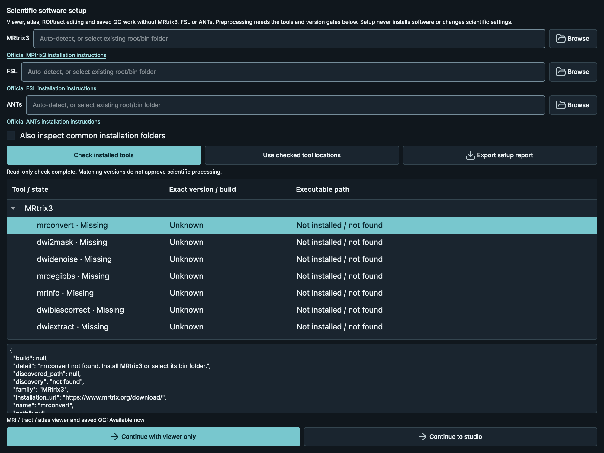
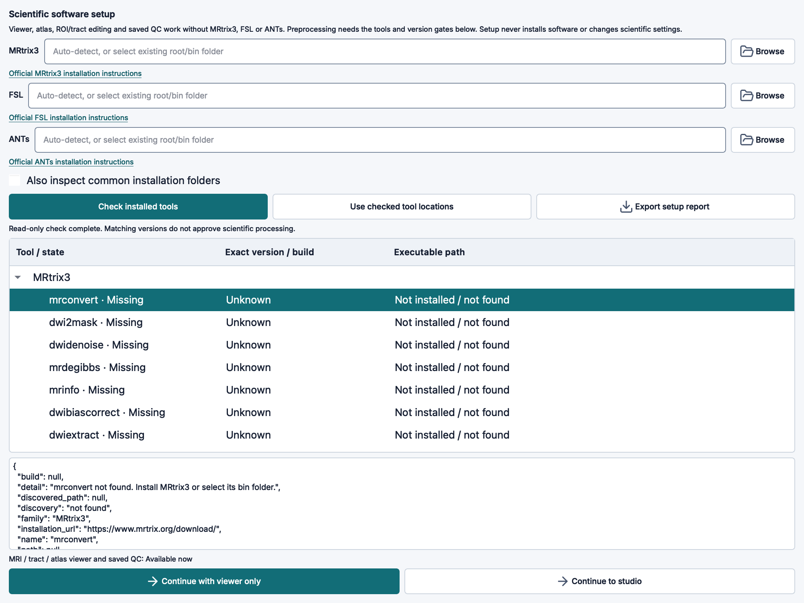
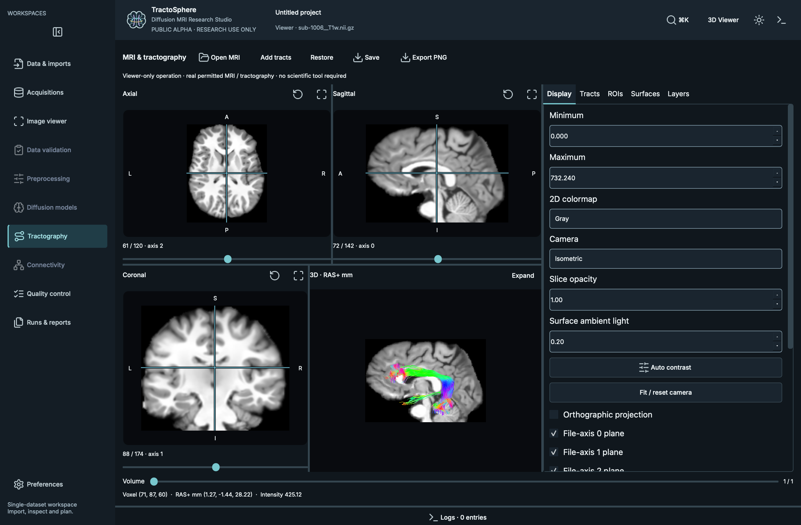
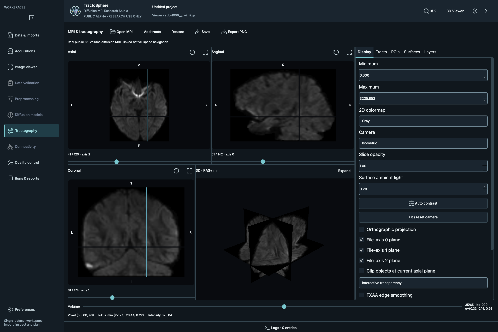
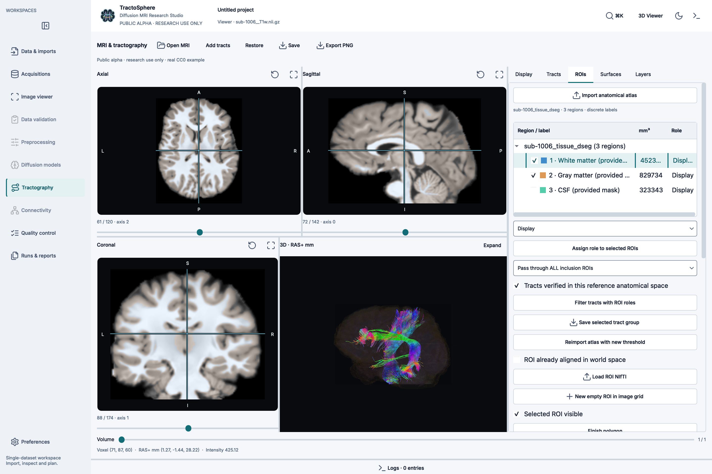
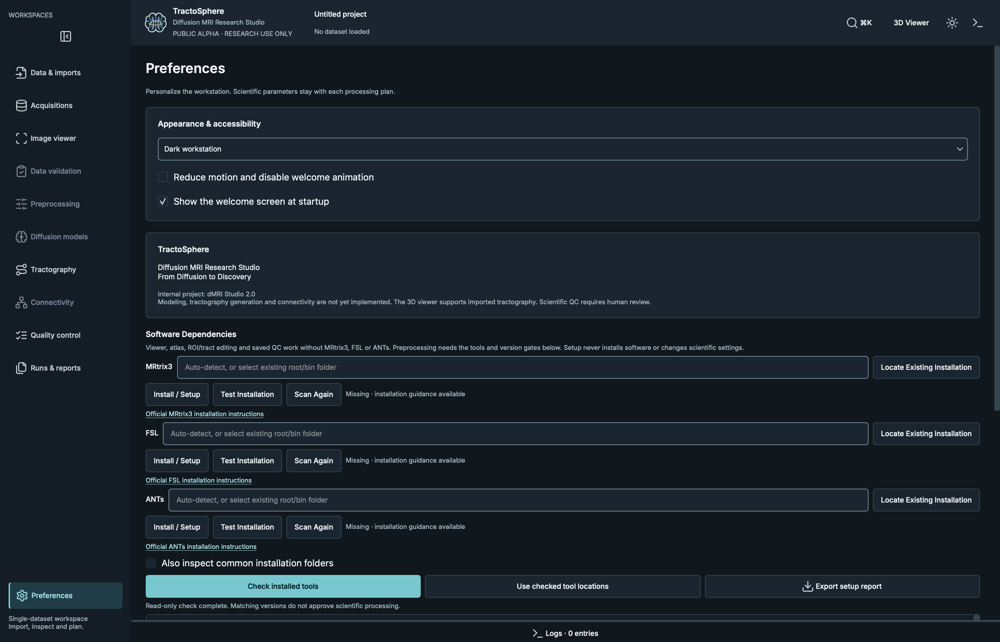
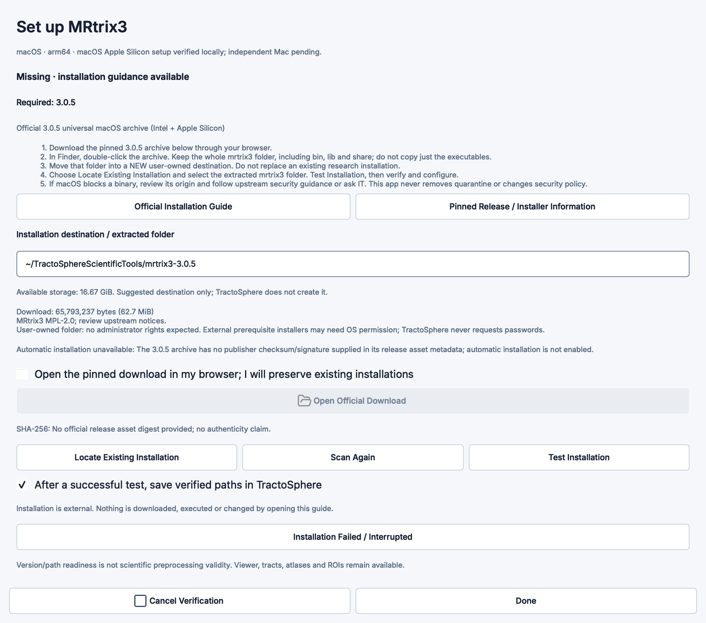
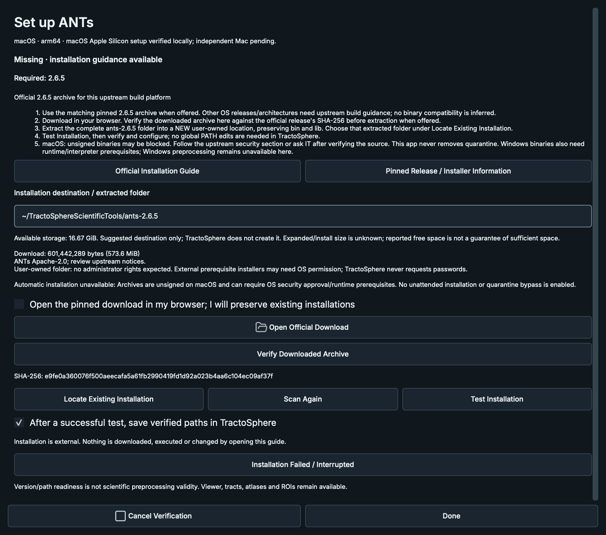
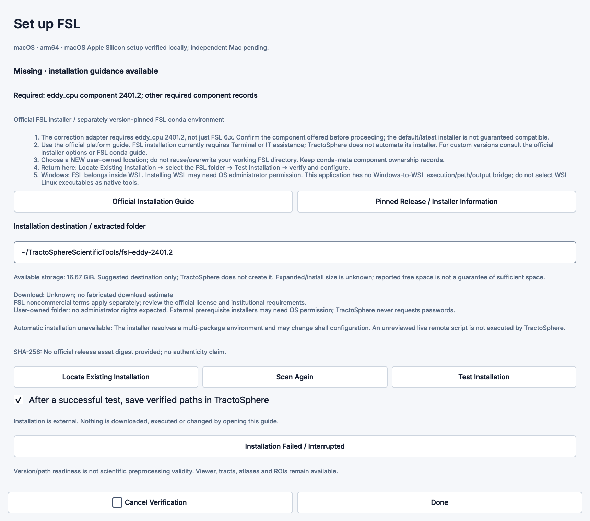

# Alpha validation record

PUBLIC ALPHA · RESEARCH USE ONLY · SCIENTIFIC VALIDATION ONGOING

## Phase 3 update — 2026-10-14

The latest cross-platform results are in [Phase 3 validation](cross_platform_validation_phase3.md).
Public candidate: 762 passed / 2 optional skips on native macOS; 749 passed /
15 external-tool skips on Ubuntu 24.04 ARM64 VM. These supersede earlier suite
counts below. Native Windows/Intel Mac and remote CI remain unverified.

## What was actually tested

2026-10-14, macOS Apple Silicon on an Apple M5 workstation with 16 GB RAM.
Python 3.12.15; fresh venv with system packages disabled. The GUI extra was
installed from the public candidate source using pip, not borrowed from the
existing research environment. Dependency checks passed. The companion macOS helper also installed the release wheel into a second new isolated venv and passed pip checks/version verification. The checksum-verified installed wheel was launched through its actual dmri-studio view entry point.

- Original private development checkout: **751 passed / 127.54 seconds**.
- Cleaned public candidate with dependency setup: **724 passed, 2 skipped / 152.39 seconds**.
- The two skips require a verified local MRtrix/ANTs installation and the verified
  FSL/MRtrix/pinned HCP combination helper. They are not claimed as fresh-install
  execution passes. No lengthy EDDY or full preprocessing run was launched.
- Private study-only scripts and their tests were excluded from the public tree.
  Their original source/tests/results remain preserved locally. An independent
  Gibbs-axis acquisition test was retained. No application verification threshold
  or scientific acceptance rule was weakened.
- Native installed alpha GUI: actual public TractoInferno sub-1006 T1, 65-volume
  DWI, real AF_L TCK (18,375 fibers) and PYT_L TRK (65,734 fibers), linked position,
  multiple actual tissue-region surfaces, morphology/undo, volumetric ROI roles,
  dark/light screenshots and unchanged original SHA-256 checks.
- The existing native ROI/Tracts button audit covers color/opacity, selection,
  draw/erase/polygon, morphology, editing/undo/redo, export, coordinate checks,
  workspace restoration and control accessibility. The release audit completed in 67.75 seconds while another native inspection was open.
- Previously verified JHU discrete/probabilistic atlas tests: 50 positive labels
  in the installed discrete file; 20 probability maps at 0.25, 13 nonempty at 0.50;
  names/IDs, opacity/color, multiple surfaces, source hashes and MNI/native refusal.
  Those FSL assets and their screenshots are not redistributed.
- Wheel/source archive and macOS helper are checked for MRI arrays, credentials,
  private records and inappropriate absolute paths. Installation artifacts and
  exact private logs are retained outside the published tree.

## First-run dependency setup verification

The updated alpha wheel was checksum-verified and installed by the macOS helper
into a new, non-editable Python 3.12.15 venv with system packages disabled. Pip
reported no broken requirements. This is a **clean application installation on an
existing macOS host**, not a freshly reinstalled OS or a second physical Mac.
Independent physical-Mac verification remains pending and is disclosed for this alpha.

- Actual GUI entry point and welcome Enter interaction opened the first-run dialog.
- A controlled child PATH and disabled common-folder search hid all scientific
  tools: all 24 executables were reported missing, viewer-only continuation worked,
  and real CC0 MRI/TCK loaded successfully. Setup choice suppressed the dialog on
  a subsequent window. Source hashes stayed unchanged; native audit: 19.25 seconds.
- Normal installed-tool discovery used the same installed wheel and passed the
  native flow. MRtrix3 3.0.5 and FSL component/build records were detected. N4 absent
  from normal PATH was reported missing, rather than guessed from research history.
- A separately selected existing ANTs directory was read-only inventoried with
  N4 2.6.5. EDDY component 2401.2 was distinguished from suite 6.0.7.18 and its
  actual binary from its FSL launcher. No scientific commands were run by setup.
- 14 new setup tests cover version/provenance gates, missing/unrecognized/mixed
  installations, explicit path precedence, query timeout/cancellation, responsive
  workers, viewer-only continuation, repeat suppression, unchanged active-run
  configuration, stale-scan rejection, safe close and accessible official links.
- After the final console/build display refinements, the 15-test focused dependency
  and command-palette set passed in 16.35 seconds; Ruff passed. Version gates and
  scientific processing settings were not relaxed.

## Screenshots and data

These are captures of the real application, not generated mockups. The native
three-tissue label fixture comes from the subject's supplied, disjoint WM/GM/CSF
masks. It is not a new cortical parcellation or a transformed JHU atlas.
Source: https://openneuro.org/datasets/ds003900 (CC0).

## What is not established

Tests establish bounded software behavior and numerical contracts. They do not
establish universal preprocessing readiness or scientific acceptance. Historical
research comparators are not ground truth. No clinical validation, cross-platform
native GUI acceptance, exhaustive GPU benchmark, notarized standalone app or
large-scale cohort validation is claimed.

GitHub CI is configured for future public headless matrix tests and macOS GUI
checks. Configured jobs are not reported as completed results. Private-repository
runs are gated off to avoid consuming paid private Actions allowance.

Scientific interpretation of masks, registration, CNR/prediction failures,
partial-Fourier artifacts and bias fields still requires expert review. See
limitations.md and THIRD_PARTY_NOTICES.md.

## Guided installation extension, 2026-10-14

Reuses the existing detector/worker. Public regression: 746 passed, 2 optional
external-tool skips / 176.05 seconds. New focused guidance/GUI set: 22 passed
/ 16.99 seconds. A native real Qt audit opened all three guided dialogs in dark
and light themes, verified the existing ANTs 2.6.5 version, configured only
test-owned preferences and preserved the executable hash. No installer, privilege
request, quarantine removal or MRI processing was executed. Official MRtrix
3.0.5 archive was inspected (universal Intel/ARM header and complete lib sources);
that inspection is not a publisher signature or a new-install execution claim.

Mocked browser/externally-created synthetic install folders cover consent, missing,
compatible/incompatible, incorrect/custom folders, user-reported external failure,
cancellation/close, browser launch failure, low disk space, permissions, settings
write rollback, persistence and archive size/digest failures. These are not claims
of live installation/network/WSL verification. Independent Mac installation remains pending. This public repository uses a separately audited fresh history; private development history is excluded. No automated scientific
installer is enabled.

## Phase 5/6 release verification — 2026-10-14

The audited wheel passed a new isolated Python 3.12.15 installation on macOS 26.3
Apple Silicon (Apple M5, 16 GiB), with system site packages disabled and installed
module paths verified. All 156 package files matched wheel bytes. Actual native
Qt/VTK checks passed for startup/shutdown, real 65-volume public MRI, linked views,
real TCK/TRK, atlas regions, surfaces, ROI morphology/undo/filtering, dark/light
rendering, first-run viewer-only continuation, guided setup and saved MRtrix/FSL/
ANTs paths. Original public-data hashes remained unchanged. A relative-path
assertion in an optional setup harness was resolved by supplying an absolute path;
no application change was needed. Independent physical Mac remains pending.

The public release uses a fresh Git snapshot with noreply metadata. Only repository
links/documentation and packaging metadata changed for Phase 6; prior scientific,
GUI and cross-platform evidence is reused. Security checks and targeted wheel
installation are repeated on final artifacts. No external scientific executables
or MRI arrays are distributed.
